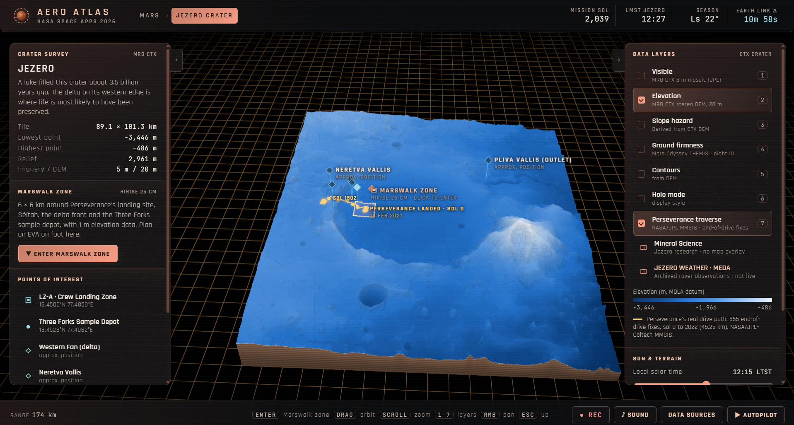
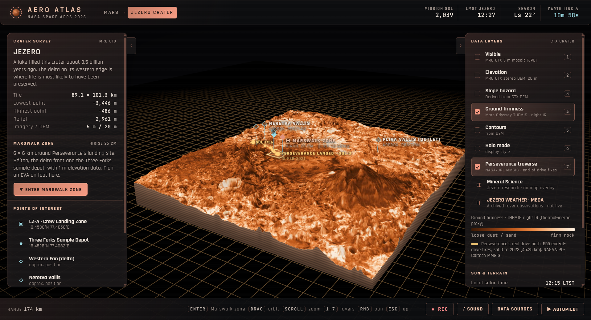
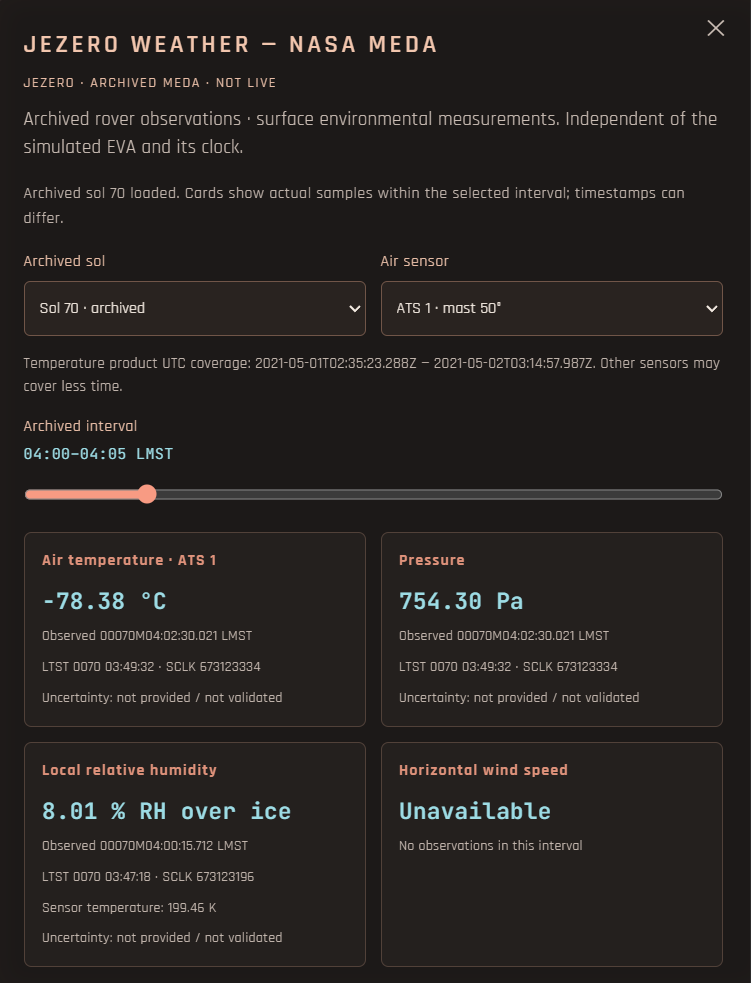
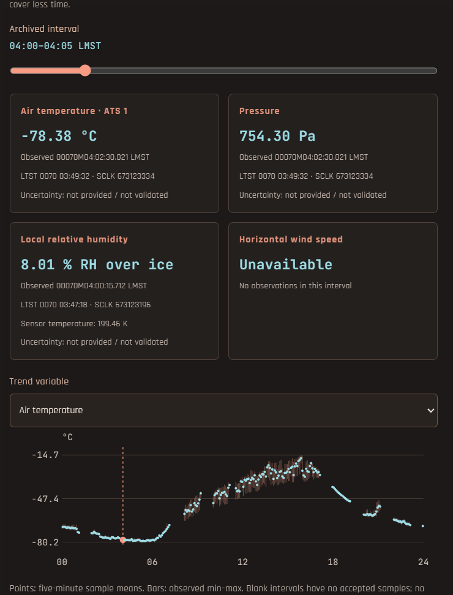
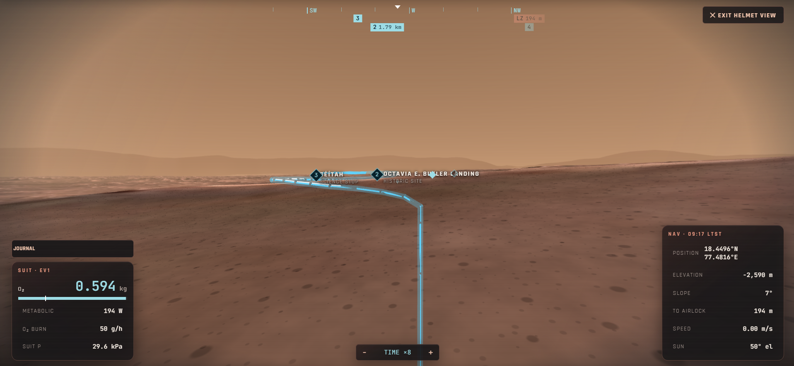
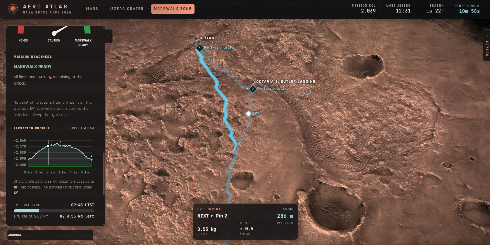

# AERO ATLAS

## Explore Mars. Plan the EVA. Understand the cost of every step.

**Interactive Martian Exploration & EVA Survival Planning System — Team 4 Loops**

<<<<<<< HEAD
Screenshots below document the original Sol Atlas build; historical branding in those captures is retained.
=======
### [Launch Aero Atlas — Live Demo](https://aeroatlas.onrender.com)

Aero Atlas connects planetary exploration, terrain analysis, mission planning and simulated surface operations in one browser application. Start with the Mars globe, descend into Jezero Crater, inspect the terrain, plan an expedition, then follow the astronaut from above or through a first-person helmet view.
>>>>>>> f2e5999045dd295d4db076c32c89edefdc9071dc

Presented in the context of NASA Space Apps 2026 and the *Interplanetary Survival Guide: Martian Map* challenge. This is an independent educational prototype, not a certified operational tool or an agency endorsement.

## Short description

Aero Atlas is a browser-based Mars exploration and EVA planning simulator by Team 4 Loops. It combines NASA-derived 3D terrain, oxygen-aware route planning, first-person exploration, archived MEDA weather, and a mission journal to help users understand how terrain, time, and resources shape a simulated Mars expedition.

See [PROJECT_DESCRIPTION.md](PROJECT_DESCRIPTION.md) for a separate reusable description.

## Team 4 Loops

- **Arpan Biswas**
- **Ayan Kumar Mondal**
- **Aritra Adak**
- **Aritra Pal**

<<<<<<< HEAD
- [How it works](#how-it-works)
- [What's new in the polish build](#whats-new-in-the-polish-build)
- [Data layers](#data-layers)
- [The science behind the numbers](#the-science-behind-the-numbers)
- [Places on the map](#places-on-the-map)
- [Controls](#controls)
- [Phones, tablets and performance](#phones-tablets-and-performance)
- [Recording the pitch video](#recording-the-pitch-video)
- [Run it locally](#run-it-locally)
- [Testing and maintenance](#testing-and-maintenance)
- [Dataset sources and processing](#dataset-sources-and-processing)
- [Rebuild the NASA data](#rebuild-the-nasa-data)
- [Deploy](#deploy)
- [Project structure](#project-structure)
- [Limitations and roadmap](#limitations-and-roadmap)
- [Credits](#credits)
- [Licence](#licence)
=======
## Objective and problem
>>>>>>> f2e5999045dd295d4db076c32c89edefdc9071dc

A scientifically interesting destination is not automatically a feasible EVA target. A straight line on a map cannot explain climbing effort, oxygen consumption, science-stop duration or the reserve required to return home. Scientific datasets also operate at different scales and observation dates.

Our objective is to make those relationships visible and understandable. Aero Atlas connects planetary context with local terrain, uses explicit assumptions to estimate an expedition's resource budget, and lets users revise and experience their plan. Students, educators, space enthusiasts and developers can explore the tradeoffs without needing a specialized desktop GIS installation.

## Our differentiator

The project brings several capabilities into one connected learning workflow. These are design strengths, not claims of exclusive features across all planetary software.

| Capability | User benefit |
| --- | --- |
| Globe → crater → Marswalk → helmet | Keep geographic context while changing scale. |
| Terrain-aware and oxygen-aware routing | Compare resource cost and return feasibility, not just distance. |
| Editable EVA assumptions | Understand why a route changes from ready to caution or no-go. |
| Return and rover walkback checks | Evaluate getting home as well as reaching a destination. |
| Recorded movement versus planned route | Review what the simulated astronaut actually did. |
| Scientific provenance and missing-data labels | Distinguish evidence, interpretation and unavailable readings. |
| Separate MEDA and DONKI panels | Keep archived surface measurements separate from solar advisories. |
| Browser-local mission history | Record and review missions without a cloud account. |

## Current feature guide

### Exploration and terrain

The globe displays mission-derived imagery and orbital layers. Jezero is the detailed unlocked destination; other landing sites are future expansion points. Crater terrain provides regional context, while the approximately 6 × 6 km Marswalk zone supports local route planning. Available views include imagery, elevation, slope hazard, thermal context, contours, holographic styling and the bundled Perseverance traverse.

### Planning and surface simulation

Choose a science goal, add stops or drop a custom pin. The planner computes terrain-aware routes with A* and estimates distance, time, metabolic effort, oxygen and return constraints. It supports walking and rover travel with walkback limits. The readiness gauge presents categories, not a survival probability. The profile relates elevation changes to distance; playback advances EV1 and shows wrist telemetry.

Helmet view connects eye-level terrain exploration with simulated suit oxygen, metabolic power, burn rate, navigation and time progression. The proposed crew landing zone is a scenario assumption, not an existing human base.

### EVA Journal

Start recording from the Journal while in helmet view or EV1 playback. Record actual simulated movement, pause/resume, add categorized notes, review saved history and export PNG report pages. IndexedDB stores history in the current browser and origin. Clearing site data can erase missions; there is no automatic cloud backup.

Recorded and planned routes are separate. Missing telemetry remains unavailable. Oxygen summaries use comparable readings within sessions and identify partial coverage instead of counting refills or resets as consumption. Journal recording differs from the footer REC screen-capture control.

### Archived MEDA weather

**JEZERO WEATHER · MEDA** opens from Data layers and the planner. Archived sols 70 and 71 contain temperature, pressure, relative humidity over ice and wind observations. The drawer provides sensor selection, interval selection, timestamps, five-minute trend summaries, quality exclusions and scientific provenance.

MEDA is not live weather, a forecast or a terrain-wide environmental map. Missing observations stay missing. The archive's observation sol is separate from the simulated mission clock and does not change the EVA calculation.

### DONKI solar advisory

NASA DONKI provides a separate WSA-ENLIL CME advisory. It is not the source of MEDA measurements. Unavailable responses are not interpreted as no solar activity. Caching, cooldowns and manual retry avoid bypassing rate limits. The advisory is excluded from the EVA verdict.

### Mineral Science

The cited reading panel distinguishes orbital and rover evidence about carbonates, olivine and water alteration. It does not place unverified mineral catalogue records on the terrain or claim confirmed sampling sites throughout the zone.

## Architecture

The core is a client-side JavaScript application built by Vite. Three.js renders the scene; HTML/CSS provides the HUD. Prepared scientific assets are served statically. An optional Netlify function supports the DONKI proxy; it is not required for terrain, MEDA archive access or local Journal storage.

<<<<<<< HEAD
| Feature | Why it matters |
|---|---|
| **O₂-exhaustion point** on the route, in the profile and in the simulation | You see *where* a bad plan kills the astronaut, not just that it's NO-GO |
| **Mayday light-time** at the moment O₂ runs out | Shows why Mars crews must plan for themselves: Earth hears the call ~14 min later |
| **Drop a pin, route anywhere** | Plan to any point in the zone, not only named places |
| **Helmet view** with the real skyline | The only first-person view we know of that's built on the actual DTM and horizon |
| **Perseverance's real traverse** | More real mission data: 555 drive fixes over 2,022 sols |
| **Synthesised sound** (♪ / `M`) | Wind, lock-on, alarms, suit breathing. All generated in the browser, no audio files |
| **● REC** (`R`) | Records the tab (HUD and sound included) to a video file for the pitch |

Sound and REC came from ideas in a teammate's early prototype. Its imagery and several coordinates weren't reusable, so only the ideas were carried over.

---

## Data layers

Every layer is real mission data. Nothing is hand-painted. The exact files, with links, ready to paste into the Space Apps submission form, are in [Dataset sources and processing](#dataset-sources-and-processing).

| Level | Layer | Mission / instrument | Product |
|---|---|---|---|
| Orbit | Visible colour | Viking Orbiters | MDIM 2.1 global mosaic, NASA Ames colour (232 m/px) |
| Orbit | Topography, relief | Mars Global Surveyor · MOLA | MOLA 128/64 ppd merged DEM (463 m/px) |
| Orbit | Night thermal IR | Mars Odyssey · THEMIS | USGS controlled night-IR mosaic (100 m/px) |
| Orbit | Human Exploration Zones (overlay, `Z`) | NASA human landing-site workshop, 2015 | 38 proposed zones, 100 km radius (centres compiled by USGS) |
| Orbit | Geologic map, rock unit and age under the cursor | USGS-NASA Planetary Geologic Mapping Program (mapped on MOLA and THEMIS) | Geologic Map of Mars, USGS SIM 3292 (Tanaka et al. 2014), 1:20 million |
| Orbit, zoomed in on Jezero and Isidis | Relief, elevation colours | **ESA Mars Express · HRSC**, with MGS MOLA | HRSC and MOLA blended DEM v2, 200 m/px (USGS; HRSC data ESA/DLR/FU Berlin) |
| Crater | Visible | MRO · CTX | Mars 2020 Science Investigation CTX orthomosaic, 5 m/px (JPL) |
| Crater | Elevation, slope, contours | MRO · CTX stereo | Mars 2020 Science Investigation CTX DEM, 20 m/px (JPL) |
| Crater + zone | Ground firmness | Mars Odyssey · THEMIS | Night-IR mosaic as a thermal-inertia proxy, 100 m/px |
| Marswalk zone | Visible | MRO · HiRISE | Mars 2020 Terrain-Relative-Navigation orthomosaic, 25 cm/px (USGS) |
| Marswalk zone | Elevation, slope, route | MRO · HiRISE stereo | Mars 2020 TRN DTM, 1 m/px (USGS) |
| Crater + zone | Perseverance traverse | Mars 2020 · rover localisation | NASA/JPL MMGIS "Where is Perseverance?" end-of-drive waypoints, sol 0–2022, from the [MMGIS feed](https://mars.nasa.gov/mmgis-maps/M20/Layers/json/M20_waypoints.json) |
| Marswalk zone | Stop photos | Mars 2020 · Navcam, Mastcam-Z | Raw images from the stops: landing site (sol 16), Three Forks (sol 690), Séítah (sol 249), delta front (sol 502) |
| Helmet view | Skyline | MRO · CTX stereo | Computed from the 20 m crater DEM: highest angle per bearing, Mars curvature included |
| Phase 2 | Minerals | MRO · CRISM | not yet: shown as locked |
| Marswalk zone, orbit clock | Space weather at Mars (live) | NASA DONKI · WSA-ENLIL model (NASA Goddard CCMC) | CME arrival forecasts for Mars over the last 30 days, fetched when the app opens (`api.nasa.gov`) |
| Phase 2 | Live weather | Perseverance · MEDA | not yet: the conditions panel shows typical values, labelled "not live" |

"Ground firmness" works like this: rock and coarse grains stay warm through the night, while dust and fine sand cool fast. So night-time infrared brightness tells firm ground from loose ground.

---

## Dataset sources and processing

NASA map products are obtained through the USGS Astrogeology public `asc-pds-services` archive. Source resolutions differ from the processed display and routing resolutions listed below. These are retained provenance records, not a claim that every external endpoint has been rechecked during documentation cleanup.

### NASA sources

```
- Viking Orbiter 1 & 2: Mars MDIM 2.1 global colour mosaic, recoloured by NASA Ames (232 m/px). Orbit view colour.
  https://asc-pds-services.s3.us-west-2.amazonaws.com/wms_basemaps/Mars/MDIM21_AMESColor/MDIM21_AMES_recolor_dd360_jpeg_cog.tif
- Mars Global Surveyor, MOLA: 128/64 pixels-per-degree merged global elevation model (~463 m). Orbit view relief and elevation colours.
  https://asc-pds-services.s3.us-west-2.amazonaws.com/wms_basemaps/Mars/MOLA/mola128_mola64_merge_90Nto90S_SimpleC_clon0_cog.tif
- Mars Odyssey, THEMIS: night-time infrared controlled mosaic, 100 m, v2 (2018). Night thermal layer and "ground firmness" layer.
  https://asc-pds-services.s3.us-west-2.amazonaws.com/wms_basemaps/Mars/THEMIS_USGS/THEMIS_NightIR_ControlledMosaics_100m_v2_oct2018_cog.tif
- Mars Reconnaissance Orbiter, CTX: Mars 2020 Science Investigation orthomosaic of Jezero Crater, 5 m (NASA/JPL). Crater view imagery.
  https://asc-pds-services.s3.us-west-2.amazonaws.com/mosaic/mars2020_trn/CTX/ScienceInvestigationMaps_JPL/M20_JezeroCrater_CTXortho_mosaic_5m.tif
- Mars Reconnaissance Orbiter, CTX stereo: Mars 2020 Science Investigation elevation model of Jezero, 20 m (NASA/JPL). Crater 3D terrain, slope, contours.
  https://asc-pds-services.s3.us-west-2.amazonaws.com/mosaic/mars2020_trn/CTX/ScienceInvestigationMaps_JPL/M20_JezeroCrater_CTXDEM_20m.tif
- Mars Reconnaissance Orbiter, HiRISE: Mars 2020 Terrain-Relative-Navigation orthomosaic of the landing site, 25 cm. Marswalk zone imagery.
  https://asc-pds-services.s3.us-west-2.amazonaws.com/mosaic/mars2020_trn/HiRISE/JEZ_hirise_soc_007_orthoMosaic_25cm_Ortho_blend120.tif
- Mars Reconnaissance Orbiter, HiRISE stereo: Mars 2020 Terrain-Relative-Navigation elevation model, 1 m. Marswalk zone 3D terrain, slope, route finding, elevation profile.
  https://asc-pds-services.s3.us-west-2.amazonaws.com/mosaic/mars2020_trn/HiRISE/JEZ_hirise_soc_006_DTM_MOLAtopography_DeltaGeoid_1m_Eqc_latTs0_lon0_blend40.tif
- Mars 2020 Perseverance: rover end-of-drive positions from NASA/JPL's "Where is Perseverance?" map (MMGIS waypoint feed), sol 0 to 2022 (October 2026). Perseverance traverse layer.
  https://mars.nasa.gov/mmgis-maps/M20/Layers/json/M20_waypoints.json
- Mars 2020 Perseverance: landing site (Octavia E. Butler Landing, 18 Feb 2021), and the rover's positions at Séítah (sols 248–278) and the delta front (sols 477–502), from the waypoint feed above. Science stops in the Marswalk zone.
- Mars 2020 Perseverance raw images (Navcam and Mastcam-Z), one per science stop, taken at that spot: landing site sol 16, Three Forks sol 690, Séítah sol 249, delta front sol 502. Shown as "what you'll see" photos. Credit NASA/JPL-Caltech (Mastcam-Z: NASA/JPL-Caltech/ASU).
  https://mars.nasa.gov/mars2020/multimedia/raw-images/
- Mars 2020 Three Forks Depot bundle (NASA PDS Geosciences Node): rover latitude, longitude and elevation at each of the 10 sample-tube drops, and the sample IDs. Three Forks stop position, and the elevation check (−2,545 m).
  https://pds-geosciences.wustl.edu/m2020/urn-nasa-pds-mars2020_sample_depot_three_forks/
- USGS-NASA Planetary Geologic Mapping Program: Geologic Map of Mars, USGS Scientific Investigations Map 3292 (Tanaka et al. 2014), 1:20,000,000, mapped on MGS MOLA and Mars Odyssey THEMIS data. The globe's "Geologic map" layer (the map's own colours) and the rock unit and age shown under the cursor.
  https://asc-pds-services.s3.us-west-2.amazonaws.com/pigpen/mars/geology/SIM3292_newGlobalGeology2014/SIM3292_MarsGlobalGeologicGIS_20M_raster.zip
  https://asc-pds-services.s3.us-west-2.amazonaws.com/pigpen/mars/geology/SIM3292_forJMars/sim3292_MarsGeologicMap_JMars_64ppd.zip
  https://doi.org/10.3133/sim3292
- NASA First Landing Site / Exploration Zone Workshop for Human Missions to the Surface of Mars (Oct 2015): the 38 proposed Exploration Zones (100 km radius), centre points compiled by USGS from JMARS. Shown as rings on the globe (Display → Human Exploration Zones, key Z). Jezero and the Marswalk zone lie inside the "Jezero-Isidis-Syrtis" zone, 51 km from its centre.
  https://asc-pds-services.s3.us-west-2.amazonaws.com/pigpen/mars/Human_EZs/Human_ExplorationZones_Proposed_Oct2015.zip
- NASA GISS Mars24 sunclock algorithm (Allison & McEwen 2000): Mars time, sols, local solar time, Sun position.
  https://www.giss.nasa.gov/tools/mars24/help/algorithm.html
- NASA JPL Solar System Dynamics, "Approximate Positions of the Planets" (Standish): Earth–Mars distance and signal delay.
  https://ssd.jpl.nasa.gov/planets/approx_pos.html
- NASA DONKI (Space Weather Database Of Notifications, Knowledge, Information; Community Coordinated Modeling Center, NASA Goddard), via the NASA API portal: WSA-ENLIL CME simulations for the last 30 days, fetched live when the app opens. The Watney check and the mission clock show any CME forecast to reach Mars within three days (advisory). On 13 Nov 2026: a 726 km/s CME launched 9 Nov, forecast to glance Mars at 12:00 UTC on 13 Nov; nine CMEs forecast to reach Mars in the 30 days before.
  https://api.nasa.gov (DONKI → WSAEnlilSimulations)
- Published NASA mission results used as typical values (labelled "not live" in the app): Perseverance MEDA weather ranges; Curiosity RAD surface radiation dose (Hassler et al. 2014, Science).
=======
```mermaid
flowchart TB
  Sources[Mission imagery, elevation and MEDA products] --> Pipeline[Python terrain pipeline and Node archive builder]
  Pipeline --> Assets[public/data: images, heightmaps, metadata and JSON]
  Assets --> Loader[Asset loading and validation]
  Loader --> App[Application controller]
  App --> Globe[OrbitView]
  App --> Terrain[Crater and Marswalk TerrainView]
  Terrain --> Planner[A-star routing and EVA model]
  Planner --> Playback[EV1 playback]
  Terrain --> Helmet[First-person exploration]
  Playback --> Journal[Journal recorder and review]
  Helmet --> Journal
  Journal --> DB[(IndexedDB)]
  Journal --> Report[Canvas2D PNG export]
  App --> HUD[HUD and science panels]
  Assets --> MEDA[Archived MEDA client]
  MEDA --> HUD
  NASA[NASA DONKI] --> Proxy[Optional serverless proxy]
  Proxy --> Cache[Advisory client and cache]
  NASA --> Cache
  Cache --> HUD
>>>>>>> f2e5999045dd295d4db076c32c89edefdc9071dc
```

| Subsystem | Responsibility |
| --- | --- |
| `src/main.js`, `src/config.js` | Application lifecycle, view transitions and feature configuration. |
| `src/core/` | Assets, graphics quality, transitions and presentation coordination. |
| `src/orbit/` | Planet rendering, orbital overlays and shaders. |
| `src/terrain/` | Terrain meshes, pins, pathfinding, EVA budgeting and helmet view. |
| `src/ui/` | HUD, controls, profiles, readiness and science drawers. |
| `src/lib/` | Geography, Mars time, MEDA validation and DONKI handling. |
| `src/journal/` | Recording state, storage, replay and report composition. |
| `scripts/` | Scientific-data preparation and regression tests. |
| `netlify/functions/` | Optional server-side DONKI integration. |

<<<<<<< HEAD
```
- ESA Mars Express, HRSC (High Resolution Stereo Camera; ESA/DLR/FU Berlin): elevation models of the Jezero and Isidis region, used through the USGS "Mars HRSC MOLA Blended DEM Global 200m v2" (Fergason, Hare & Laura 2018), which merges HRSC stereo DTMs with NASA's MOLA. Relief and elevation colours on the globe when zoomed in on Jezero (200 m instead of MOLA's 463 m).
  https://asc-pds-services.s3.us-west-2.amazonaws.com/mosaic/Mars/HRSC_MOLA_Blend/Mars_HRSC_MOLA_BlendDEM_Global_200mp_v2.tif
- U.S. Geological Survey (USGS) Astrogeology Science Center: processed, controlled and archived the NASA maps above (CTX and HiRISE mosaics and elevation models, the THEMIS controlled mosaic), served from its public "asc-pds-services" archive on AWS.
- Scientific references: Pandolf, Givoni & Goldman (1977), load-carriage metabolic equation, used for the EVA oxygen model; Tobler's hiking function (walking speed vs slope); Mangold et al. (2021), Science, Jezero delta geology.
- Software: three.js (MIT licence), Vite (MIT). Python: rasterio, NumPy, Pillow, SciPy. Fonts: Rajdhani, Orbitron, JetBrains Mono (SIL Open Font Licence, via Fontsource).
- Our own assumptions (labelled in the app): proposed crew landing zone LZ-A, suit oxygen capacity 0.60 kg with a 25 % reserve, 20° walking-slope limit, approximate positions of some named places.
=======
## System flow

```mermaid
flowchart TD
  Open[Open Aero Atlas] --> Globe[Explore the Mars globe]
  Globe --> Crater[Descend to Jezero]
  Crater --> Layers[Inspect layers, landmarks and science]
  Layers --> Site[Enter Marswalk zone]
  Site --> Goal[Choose mission goal and assumptions]
  Goal --> Budget[Compute route and resource budget]
  Budget --> Review{Revise the plan?}
  Review -->|Yes| Goal
  Review -->|No| Walk[Run EV1 or enter helmet view]
  Walk --> Record[Record movement and add notes]
  Record --> Save[End and save mission]
  Save --> History[Review history and replay]
  History --> Export[Export mission report]
  Layers --> Weather[Inspect archived MEDA weather]
  Site --> Weather
>>>>>>> f2e5999045dd295d4db076c32c89edefdc9071dc
```

Scientific observations provide context, editable assumptions produce modeled plans, and simulation samples produce recorded missions. These are separate data streams. The Journal does not turn a planned route into completed movement, and the weather drawer does not turn a historical rover sol into the current mission time.

## Technology stack

| Technology | Purpose |
| --- | --- |
| JavaScript ES modules | Application and simulation logic. |
| Three.js / WebGL / GLSL | Planet, terrain, cameras, paths and graphical overlays. |
| HTML and CSS | Responsive HUD, controls, panels and dialogs. |
| SVG | Charts and profiles. |
| Canvas2D | Report composition and PNG export. |
| Vite and Node.js | Development server, production build and data tooling. |
| Python, rasterio, NumPy, Pillow, SciPy | Prepare geospatial assets for browser delivery. |
| IndexedDB | Local mission history and persistence. |
| Fetch, AbortController and browser storage | Data retrieval, cancellation and caching. |
| Netlify Functions | Optional NASA request proxy. |
| Render | Hosted frontend at the live-demo link above. |
| Node test runner / Playwright | Unit and browser regression scripts. |
| Fontsource | Rajdhani, Orbitron and JetBrains Mono fonts. |

The runtime does not require an LLM service, user-account backend or cloud database.

## Scientific interpretation and limitations

- CTX supplies crater-scale imagery and elevation; HiRISE supplies higher-resolution local products. Source resolution is not identical to the browser mesh or texture resolution after resampling.
- THEMIS night infrared is a surface-property proxy, not a direct bearing-strength measurement.
- MEDA sols 70–71 are historical observations, with different sensor coverage and explicit gaps.
- DONKI is optional and may be rate-limited; it does not alter the readiness verdict.
- The metabolic model adapts published relationships using explicit suit and Mars-gravity assumptions. It is not certified for real astronaut operations.
- Radiation uses reference context rather than a live Jezero dosimeter.
- The mineral panel provides cited interpretation, not a verified map of arbitrary sample locations.
- Browser history is local; device performance and browser capabilities affect the experience.

## Screenshot walkthrough

These 12 supplied screenshots show the Aero Atlas interface on 15 November 2026. Readings and verdicts reflect the selected route, time and settings in each capture.

### Mars globe


The globe establishes Jezero’s location, other landing sites, orbital data layers and mission-clock context.

### Crater elevation



The blue elevation ramp exposes the crater basin and surrounding relief, with the gold rover traverse and named landmarks.

### Slope hazard


Colour classes distinguish gentler and steeper terrain before route selection. This is slope classification, not a complete physical-hazard assessment.

### Ground-firmness proxy



THEMIS night infrared provides thermal context. The loose-dust-to-firm-rock legend is a proxy rather than a direct strength measurement.

### Contours and traverse


Contour lines expose relief while the bundled Perseverance traverse remains visible. The pictured legend uses 50 m intervals and stronger lines every 250 m.

### Holographic terrain


The gold technical display retains terrain shape, named features, the rover traverse and the Marswalk entry point.

### MEDA archived observations



Sol 70 at 04:00–04:05 LMST shows temperature, pressure and humidity samples. Wind is correctly labeled unavailable in this interval.

### MEDA trends



The temperature plot shows five-minute means and ranges. Blank intervals are not interpolated; the selected interval connects chart and cards.

### Mineral Science


The reading panel separates orbital carbonate evidence from rover evidence and explains limitations on placing mineral detections.

### Marswalk route and readiness


The cyan route connects science stops. Readiness explanations, oxygen reserve and an elevation profile help assess the modeled plan.

### Helmet view



Ground-level exploration retains route guidance alongside oxygen, metabolic power, navigation, slope and time-warp controls.

### EVA playback



EV1 advances along the planned route. The planner and wrist panel show progress, next-stop distance and simulated oxygen.

## Run locally

Use Node.js 22.12+ in the Node 22 release line and npm. Keep the prepared `public/data/` assets alongside the application. Python is needed only for rebuilding scientific data.

```bash
npm ci
npm run dev
```

Open the URL printed by Vite. For a production build:

```bash
npm run build
npm run preview -- --host 127.0.0.1 --port 4175
```

Serve the application over HTTP locally or HTTPS when hosted rather than opening `index.html` directly. Append `?q=low` for a lower rendering preset where supported.

## Deployment

**Live application: [https://aeroatlas.onrender.com](https://aeroatlas.onrender.com)**

The frontend build is published from `dist/`. The repository's Render configuration describes static hosting. Netlify functions are optional and are not executed by a Render static service. On a Netlify deployment, a server-side `NASA_API_KEY` can support the DONKI proxy; never include a private key in browser code. Advisory availability remains independent of terrain exploration.

## Data preparation

```bash
python -m pip install rasterio numpy pillow scipy
python scripts/build_data.py
node scripts/build_meda.mjs
```

These are maintenance operations requiring source access, time and storage, not normal startup steps. The terrain pipeline crops and resamples mission data into browser-ready textures and heightmaps. The MEDA builder prepares a pinned archive subset with provenance and checksums. Preserve original observations and review source-version changes before regeneration.

## Testing

```bash
node --test scripts/test-meda.mjs scripts/test-spaceweather.mjs scripts/test-readiness.mjs scripts/test-journal.mjs
node scripts/test-startup.cjs
npm run build
```

Browser regression scripts under `scripts/` use Playwright and a compatible Chromium installation supplied by the test environment. They cover weather, planner, Mineral Science, Journal and report interactions. Start a local server first; test scripts support `URL` and `CHROMIUM_PATH` overrides where defined. Test availability follows the checked-out source version. This documentation update does not claim a fresh application regression pass.

## Controls and suggested walkthrough

1. Launch the live demo and descend from the globe to Jezero.
2. Compare elevation, slope, thermal context and contours.
3. Enter the Marswalk zone, select a goal and adjust stops and assumptions.
4. Read the readiness explanation, return margin and elevation profile.
5. Inspect MEDA observations independently of the simulated mission clock.
6. Run EV1 playback or enter helmet view with the on-screen control or F.
7. Start Journal recording, move and add notes, then end the recording.
8. Review saved history and export a mission report.

Drag and scroll control the orbital/terrain camera; right-drag pans where supported. Number keys select available layers. Escape closes dialogs or moves up according to context. Mobile uses the on-screen Planner/Crater and Layers sheets. Follow the current in-app hints for movement and shortcuts.

## Repository structure

```text
AeroAtlas/
├── README.md                   Main project documentation
├── PROJECT_DESCRIPTION.md      Short project description
├── src/
│   ├── main.js                 Application coordination
│   ├── core/                   Assets and presentation
│   ├── orbit/                  Planetary visualization
│   ├── terrain/                Terrain, routes, EVA and helmet view
│   ├── journal/                Recording, storage and reports
│   ├── ui/                     HUD, charts and science panels
│   └── lib/                    Time, geography and data clients
├── public/data/                Prepared scientific assets
├── scripts/                    Data builders and tests
├── netlify/functions/          Optional DONKI service
├── docs/screenshots/team-4-loops/  Current screenshots
├── docs/README-legacy.md        Archived previous documentation
└── dist/                       Compiled frontend
```

## Future work

Potential extensions include more validated exploration regions, broader MEDA archive coverage, clearer uncertainty communication, more complete recording recovery tests and optional portable mission-data exports. These are directions for development, not completed features. Each new science layer should include coverage and provenance before it is presented as evidence.

<<<<<<< HEAD
## Credits

**Original team:** The SOL Explorers, NASA Space Apps Challenge 2026, Bangladesh.

| Member | Role |
|---|---|
| S.M. Riasijtur Rahman | Team owner |
| MD. Yemtias Jani Mishad | Team member |
| Md Rifat Hasan | Team member |
| Sayma Ferdousi Fariha | Team member |

**Data:**
- NASA / JPL-Caltech / University of Arizona (HiRISE)
- NASA / JPL-Caltech / MSSS (CTX)
- NASA / JPL-Caltech / Arizona State University (THEMIS)
- NASA / GSFC (MOLA)
- NASA / USGS (Viking MDIM 2.1, NASA Ames colour)
- ESA / DLR / FU Berlin (Mars Express HRSC), in the USGS HRSC and MOLA blended DEM (Fergason, Hare & Laura 2018)
- USGS Astrogeology Science Center (mosaics and DTMs)
- Mars 2020 science maps: Mangold et al. (2021), *Science*
- Perseverance waypoints: NASA/JPL-Caltech MMGIS ("Where is Perseverance?")

**Ideas:** synthesised sound design and in-app recording were inspired by a teammate's early prototype.

NASA imagery is not copyrighted. No NASA logos are used.

**Built with:** [three.js](https://threejs.org), [Vite](https://vitejs.dev) and Python ([rasterio](https://rasterio.readthedocs.io), NumPy, Pillow, SciPy). Fonts: Rajdhani, Orbitron, JetBrains Mono.

---

## Licence

The code in this repository is open source under the [Apache License 2.0](LICENSE), as NASA Space Apps requires for work built for the challenge. The NASA data in `public/data/` is not copyrighted and is credited above. The fonts are under the SIL Open Font Licence; three.js and Vite are under the MIT licence.
## Archived MEDA weather

Jezero Weather opens from the crater/Marswalk data panel. It displays verified, locally packaged Perseverance MEDA observations for archived sols 70–71, with separate sensor timestamps, five-minute trend summaries, missing-data states and PDS citations. It is **not live weather** and does not change EVA calculations. See [MEDA_DATA.md](MEDA_DATA.md) for provenance, quality rules, regeneration and tests.
=======
## AI use disclosure

Claude Code assisted with the original implementation and data-processing code under human direction. OpenAI Codex assisted with subsequent development, debugging, testing and documentation. The team defines the objectives, reviews features, tests the experience and reports issues.

Scientific inputs are mission datasets and published research, not AI-generated observations. The screenshots are user-supplied captures of the application. AI assistance during development does not imply an AI inference service at runtime.

## Credits and license

**Team 4 Loops:** Arpan Biswas, Ayan Kumar Mondal, Aritra Adak and Aritra Pal.

Data and scientific context are credited to NASA mission teams, NASA/JPL-Caltech, USGS Astrogeology, ESA/DLR/FU Berlin and instrument/research teams. Their names identify sources rather than endorsement. Mission imagery, geological products, fonts and dependencies retain their applicable terms and attribution requirements.

The project code is distributed under [Apache-2.0](LICENSE). The [previous README](docs/README-legacy.md) is retained for historical provenance and detailed original references; its older branding and dated claims are archival, not the main project introduction.
>>>>>>> f2e5999045dd295d4db076c32c89edefdc9071dc
