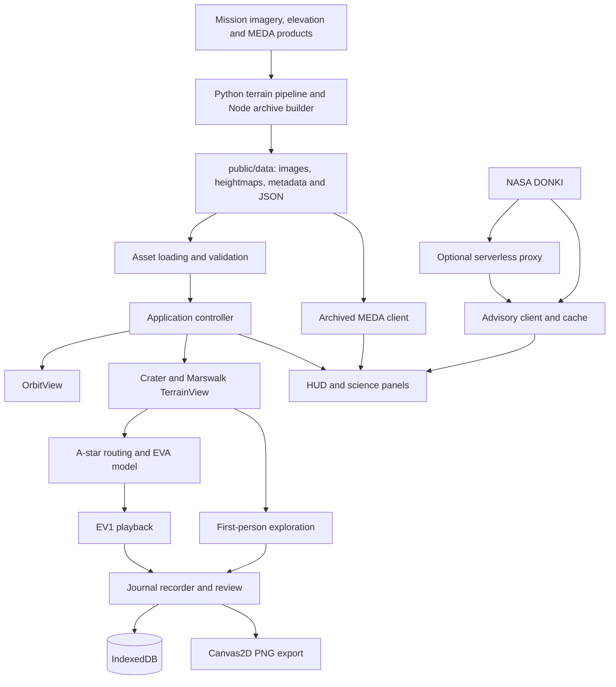
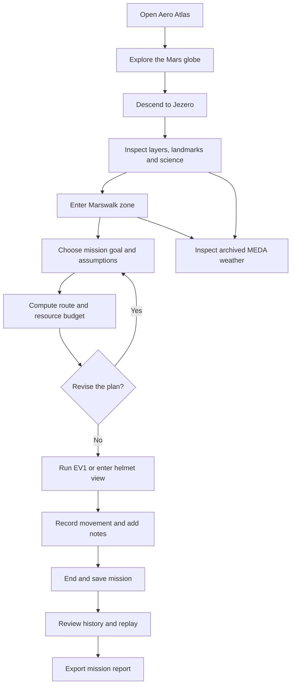
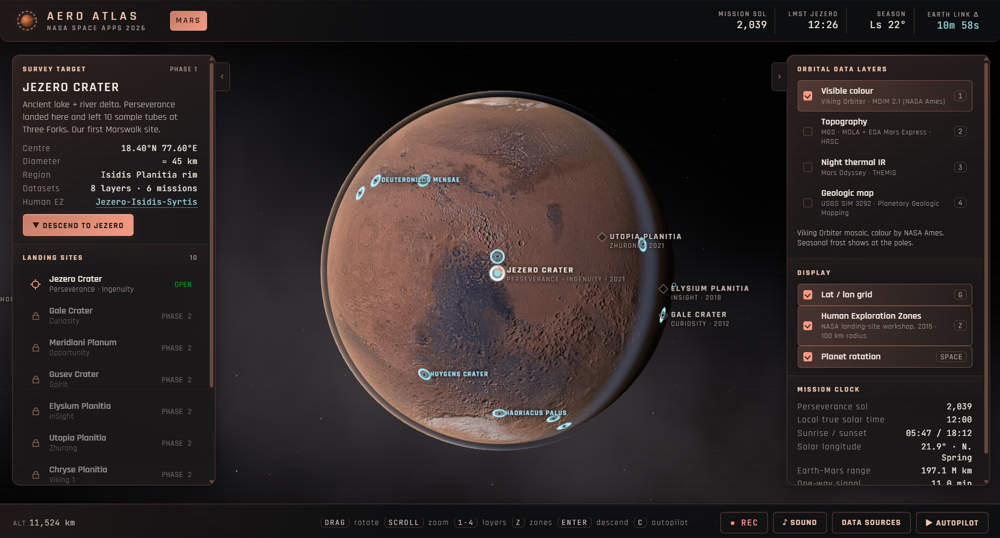
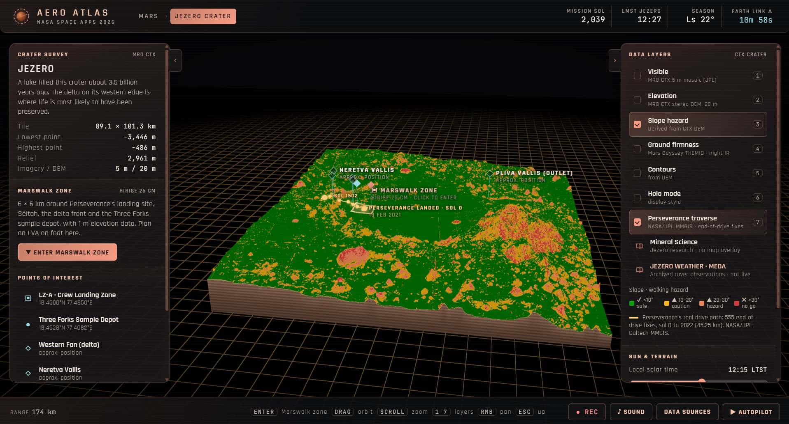
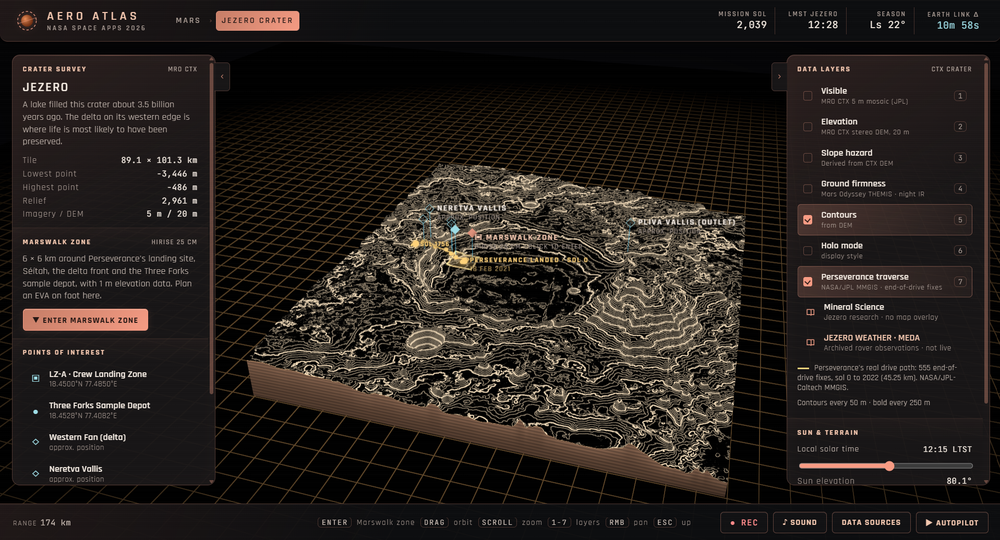
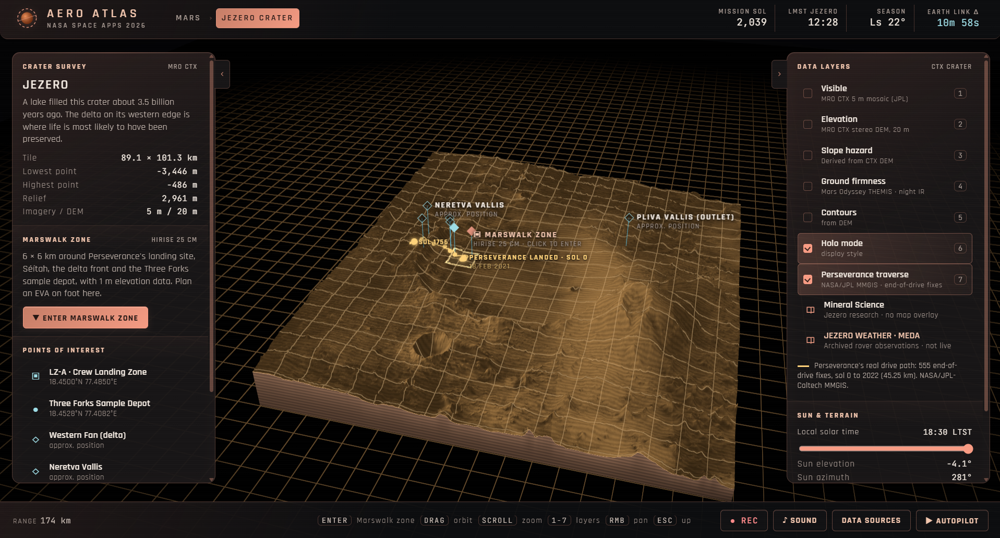
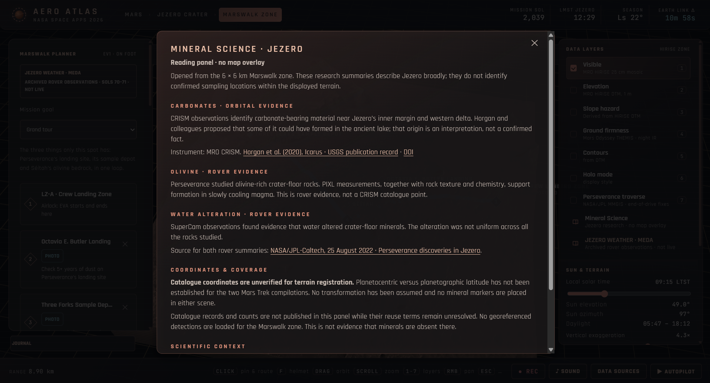
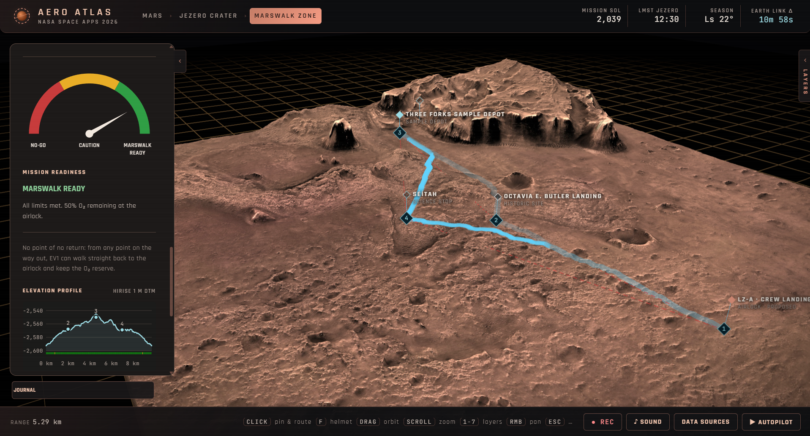

# AERO ATLAS

## Explore Mars. Plan the EVA. Understand the cost of every step.

**Interactive Martian Exploration & EVA Survival Planning System — Team 4 Loops**

### [Launch Aero Atlas — Live Demo](https://aeroatlas.onrender.com)

Aero Atlas connects planetary exploration, terrain analysis, mission planning and simulated surface operations in one browser application. Start with the Mars globe, descend into Jezero Crater, inspect the terrain, plan an expedition, then follow the astronaut from above or through a first-person helmet view.

Presented in the context of NASA Space Apps 2026 and the *Interplanetary Survival Guide: Martian Map* challenge. This is an independent educational prototype, not a certified operational tool or an agency endorsement.

## Short description

Aero Atlas is a browser-based Mars exploration and EVA planning simulator by Team 4 Loops. It combines NASA-derived 3D terrain, oxygen-aware route planning, first-person exploration, archived MEDA weather, and a mission journal to help users understand how terrain, time, and resources shape a simulated Mars expedition.

See [PROJECT_DESCRIPTION.md](PROJECT_DESCRIPTION.md) for a separate reusable description.

## Team 4 Loops

- **Arpan Biswas**
- **Ayan Kumar Mondal**
- **Aritra Adak**
- **Aritra Pal**

## Contents

- [Objective and problem](#objective-and-problem)
- [Our differentiator](#our-differentiator)
- [Current feature guide](#current-feature-guide)
- [Architecture](#architecture)
- [System flow](#system-flow)
- [Technology stack](#technology-stack)
- [Scientific interpretation and limitations](#scientific-interpretation-and-limitations)
- [Screenshot walkthrough](#screenshot-walkthrough)
- [Run locally](#run-locally)
- [Deployment](#deployment)
- [Android development](#android-development)
- [Data preparation](#data-preparation)
- [Testing](#testing)
- [Controls and suggested walkthrough](#controls-and-suggested-walkthrough)
- [Repository structure](#repository-structure)
- [Future work](#future-work)
- [AI use disclosure](#ai-use-disclosure)
- [Credits and license](#credits-and-license)

## Objective and problem

A scientifically interesting destination is not automatically a feasible EVA target. A straight line on a map cannot explain climbing effort, oxygen consumption, science-stop duration or the reserve required to return home. Scientific datasets also operate at different scales and observation dates.

Our objective is to make those relationships visible and understandable. Aero Atlas connects planetary context with local terrain, uses explicit assumptions to estimate an expedition's resource budget, and lets users revise and experience their plan. Students, educators, space enthusiasts and developers can explore the tradeoffs without needing a specialized desktop GIS installation.

## Our differentiator

The project brings several capabilities into one connected learning workflow. These are design strengths, not claims of exclusive features across all planetary software.

| Capability | User benefit |
| --- | --- |
| Globe → crater → Marswalk → helmet | Keep geographic context while changing scale. |
| Terrain-aware and oxygen-aware routing | Compare resource cost and return feasibility, not just distance. |
| Editable EVA assumptions | Understand why a route changes from ready to caution or no-go. |
| Return and rover walkback checks | Evaluate getting home as well as reaching a destination. |
| Recorded movement versus planned route | Review what the simulated astronaut actually did. |
| Scientific provenance and missing-data labels | Distinguish evidence, interpretation and unavailable readings. |
| Separate MEDA and DONKI panels | Keep archived surface measurements separate from solar advisories. |
| Browser-local mission history | Record and review missions without a cloud account. |

## Current feature guide

### Exploration and terrain

The globe displays mission-derived imagery and orbital layers. Jezero is the detailed unlocked destination; other landing sites are future expansion points. Crater terrain provides regional context, while the approximately 6 × 6 km Marswalk zone supports local route planning. Available views include imagery, elevation, slope hazard, thermal context, contours, holographic styling and the bundled Perseverance traverse.

### Planning and surface simulation

Choose a science goal, add stops or drop a custom pin. The planner computes terrain-aware routes with A* and estimates distance, time, metabolic effort, oxygen and return constraints. It supports walking and rover travel with walkback limits. The readiness gauge presents categories, not a survival probability. The profile relates elevation changes to distance; playback advances EV1 and shows wrist telemetry.

Helmet view connects eye-level terrain exploration with simulated suit oxygen, metabolic power, burn rate, navigation and time progression. The proposed crew landing zone is a scenario assumption, not an existing human base.

### EVA Journal

Start recording from the Journal while in helmet view or EV1 playback. Record actual simulated movement, pause/resume, add categorized notes, review saved history and export PNG report pages. IndexedDB stores history in the current browser and origin. Clearing site data can erase missions; there is no automatic cloud backup.

Recorded and planned routes are separate. Missing telemetry remains unavailable. Oxygen summaries use comparable readings within sessions and identify partial coverage instead of counting refills or resets as consumption. Journal recording differs from the footer REC screen-capture control.

### Archived MEDA weather

**JEZERO WEATHER · MEDA** opens from Data layers and the planner. Archived sols 70 and 71 contain temperature, pressure, relative humidity over ice and wind observations. The drawer provides sensor selection, interval selection, timestamps, five-minute trend summaries, quality exclusions and scientific provenance.

MEDA is not live weather, a forecast or a terrain-wide environmental map. Missing observations stay missing. The archive's observation sol is separate from the simulated mission clock and does not change the EVA calculation.

### DONKI solar advisory

NASA DONKI provides a separate WSA-ENLIL CME advisory. It is not the source of MEDA measurements. Unavailable responses are not interpreted as no solar activity. Caching, cooldowns and manual retry avoid bypassing rate limits. The advisory is excluded from the EVA verdict.

### Mineral Science

The cited reading panel distinguishes orbital and rover evidence about carbonates, olivine and water alteration. It does not place unverified mineral catalogue records on the terrain or claim confirmed sampling sites throughout the zone.

## Architecture

The core is a client-side JavaScript application built by Vite. Three.js renders the scene; HTML/CSS provides the HUD. Prepared scientific assets are served statically. An optional Netlify function supports the DONKI proxy; it is not required for terrain, MEDA archive access or local Journal storage.



| Subsystem | Responsibility |
| --- | --- |
| `src/main.js`, `src/config.js` | Application lifecycle, view transitions and feature configuration. |
| `src/core/` | Assets, graphics quality, transitions and presentation coordination. |
| `src/orbit/` | Planet rendering, orbital overlays and shaders. |
| `src/terrain/` | Terrain meshes, pins, pathfinding, EVA budgeting and helmet view. |
| `src/ui/` | HUD, controls, profiles, readiness and science drawers. |
| `src/lib/` | Geography, Mars time, MEDA validation and DONKI handling. |
| `src/journal/` | Recording state, storage, replay and report composition. |
| `scripts/` | Scientific-data preparation and regression tests. |
| `netlify/functions/` | Optional server-side DONKI integration. |

## System flow



Scientific observations provide context, editable assumptions produce modeled plans, and simulation samples produce recorded missions. These are separate data streams. The Journal does not turn a planned route into completed movement, and the weather drawer does not turn a historical rover sol into the current mission time.

## Technology stack

| Technology | Purpose |
| --- | --- |
| JavaScript ES modules | Application and simulation logic. |
| Three.js / WebGL / GLSL | Planet, terrain, cameras, paths and graphical overlays. |
| HTML and CSS | Responsive HUD, controls, panels and dialogs. |
| SVG | Charts and profiles. |
| Canvas2D | Report composition and PNG export. |
| Vite and Node.js | Development server, production build and data tooling. |
| Python, rasterio, NumPy, Pillow, SciPy | Prepare geospatial assets for browser delivery. |
| IndexedDB | Local mission history and persistence. |
| Fetch, AbortController and browser storage | Data retrieval, cancellation and caching. |
| Netlify Functions | Optional NASA request proxy. |
| Capacitor 8 / Android | Native Android project integration using the compiled web app. |
| Render | Hosted frontend at the live-demo link above. |
| Node test runner / Playwright | Unit and browser regression scripts. |
| Fontsource | Rajdhani, Orbitron and JetBrains Mono fonts. |

The runtime does not require an LLM service, user-account backend or cloud database.

## Scientific interpretation and limitations

- CTX supplies crater-scale imagery and elevation; HiRISE supplies higher-resolution local products. Source resolution is not identical to the browser mesh or texture resolution after resampling.
- THEMIS night infrared is a surface-property proxy, not a direct bearing-strength measurement.
- MEDA sols 70–71 are historical observations, with different sensor coverage and explicit gaps.
- DONKI is optional and may be rate-limited; it does not alter the readiness verdict.
- The metabolic model adapts published relationships using explicit suit and Mars-gravity assumptions. It is not certified for real astronaut operations.
- Radiation uses reference context rather than a live Jezero dosimeter.
- The mineral panel provides cited interpretation, not a verified map of arbitrary sample locations.
- Browser history is local; device performance and browser capabilities affect the experience.

## Screenshot walkthrough

These 12 supplied screenshots show the Aero Atlas interface on 15 November 2026. Readings and verdicts reflect the selected route, time and settings in each capture.

### Mars globe



The globe establishes Jezero’s location, other landing sites, orbital data layers and mission-clock context.

### Crater elevation


The blue elevation ramp exposes the crater basin and surrounding relief, with the gold rover traverse and named landmarks.

### Slope hazard



Colour classes distinguish gentler and steeper terrain before route selection. This is slope classification, not a complete physical-hazard assessment.

### Ground-firmness proxy


THEMIS night infrared provides thermal context. The loose-dust-to-firm-rock legend is a proxy rather than a direct strength measurement.

### Contours and traverse



Contour lines expose relief while the bundled Perseverance traverse remains visible. The pictured legend uses 50 m intervals and stronger lines every 250 m.

### Holographic terrain



The gold technical display retains terrain shape, named features, the rover traverse and the Marswalk entry point.

### MEDA archived observations


Sol 70 at 04:00–04:05 LMST shows temperature, pressure and humidity samples. Wind is correctly labeled unavailable in this interval.

### MEDA trends


The temperature plot shows five-minute means and ranges. Blank intervals are not interpolated; the selected interval connects chart and cards.

### Mineral Science



The reading panel separates orbital carbonate evidence from rover evidence and explains limitations on placing mineral detections.

### Marswalk route and readiness



The cyan route connects science stops. Readiness explanations, oxygen reserve and an elevation profile help assess the modeled plan.

### Helmet view


Ground-level exploration retains route guidance alongside oxygen, metabolic power, navigation, slope and time-warp controls.

### EVA playback


EV1 advances along the planned route. The planner and wrist panel show progress, next-stop distance and simulated oxygen.

## Run locally

Use Node.js 22.12+ in the Node 22 release line and npm. Keep the prepared `public/data/` assets alongside the application. Python is needed only for rebuilding scientific data.

```bash
npm ci
npm run dev
```

Open the URL printed by Vite. For a production build:

```bash
npm run build
npm run preview -- --host 127.0.0.1 --port 4175
```

Serve the application over HTTP locally or HTTPS when hosted rather than opening `index.html` directly. Append `?q=low` for a lower rendering preset where supported.

## Deployment

**Live application: [https://aeroatlas.onrender.com](https://aeroatlas.onrender.com)**

The frontend build is published from `dist/`. The repository's Render configuration describes static hosting. Netlify functions are optional and are not executed by a Render static service. On a Netlify deployment, a server-side `NASA_API_KEY` can support the DONKI proxy; never include a private key in browser code. Advisory availability remains independent of terrain exploration.

## Android development

The repository now includes Capacitor integration alongside the browser application. `capacitor.config.json` sets the app ID to `com.aeroatlas.app`, the app name to `AeroAtlas`, and the web asset directory to `dist`.

With dependencies installed and an Android development environment configured:

```bash
npm run android:sync
npm run android:open
```

The sync command builds the web app and synchronizes it into the Android project. The open command opens the project in Android Studio for device testing and native builds. These scripts do not establish a published Play Store release or a verified device-compatibility matrix.

## Data preparation

```bash
python -m pip install rasterio numpy pillow scipy
python scripts/build_data.py
node scripts/build_meda.mjs
```

These are maintenance operations requiring source access, time and storage, not normal startup steps. The terrain pipeline crops and resamples mission data into browser-ready textures and heightmaps. The MEDA builder prepares a pinned archive subset with provenance and checksums. Preserve original observations and review source-version changes before regeneration.

## Testing

```bash
node --test scripts/test-meda.mjs scripts/test-spaceweather.mjs scripts/test-readiness.mjs scripts/test-journal.mjs
node scripts/test-startup.cjs
npm run build
```

Browser regression scripts under `scripts/` use Playwright and a compatible Chromium installation supplied by the test environment. They cover weather, planner, Mineral Science, Journal and report interactions. Start a local server first; test scripts support `URL` and `CHROMIUM_PATH` overrides where defined. Test availability follows the checked-out source version. This documentation update does not claim a fresh application regression pass.

## Controls and suggested walkthrough

1. Launch the live demo and descend from the globe to Jezero.
2. Compare elevation, slope, thermal context and contours.
3. Enter the Marswalk zone, select a goal and adjust stops and assumptions.
4. Read the readiness explanation, return margin and elevation profile.
5. Inspect MEDA observations independently of the simulated mission clock.
6. Run EV1 playback or enter helmet view with the on-screen control or F.
7. Start Journal recording, move and add notes, then end the recording.
8. Review saved history and export a mission report.

Drag and scroll control the orbital/terrain camera; right-drag pans where supported. Number keys select available layers. Escape closes dialogs or moves up according to context. Mobile uses the on-screen Planner/Crater and Layers sheets. Follow the current in-app hints for movement and shortcuts.

## Repository structure

```text
AeroAtlas/
├── README.md                   Main project documentation
├── PROJECT_DESCRIPTION.md      Short project description
├── src/
│   ├── main.js                 Application coordination
│   ├── core/                   Assets and presentation
│   ├── orbit/                  Planetary visualization
│   ├── terrain/                Terrain, routes, EVA and helmet view
│   ├── journal/                Recording, storage and reports
│   ├── ui/                     HUD, charts and science panels
│   └── lib/                    Time, geography and data clients
├── public/data/                Prepared scientific assets
├── scripts/                    Data builders and tests
├── netlify/functions/          Optional DONKI service
├── docs/screenshots/team-4-loops/  Current screenshots
├── docs/README-legacy.md        Archived previous documentation
└── dist/                       Compiled frontend
```

## Future work

Potential extensions include more validated exploration regions, broader MEDA archive coverage, clearer uncertainty communication, more complete recording recovery tests and optional portable mission-data exports. These are directions for development, not completed features. Each new science layer should include coverage and provenance before it is presented as evidence.

## AI use disclosure

Claude Code assisted with the original implementation and data-processing code under human direction. OpenAI Codex assisted with subsequent development, debugging, testing and documentation. The team defines the objectives, reviews features, tests the experience and reports issues.

Scientific inputs are mission datasets and published research, not AI-generated observations. The screenshots are user-supplied captures of the application. AI assistance during development does not imply an AI inference service at runtime.

## Credits and license

**Team 4 Loops:** Arpan Biswas, Ayan Kumar Mondal, Aritra Adak and Aritra Pal.

Data and scientific context are credited to NASA mission teams, NASA/JPL-Caltech, USGS Astrogeology, ESA/DLR/FU Berlin and instrument/research teams. Their names identify sources rather than endorsement. Mission imagery, geological products, fonts and dependencies retain their applicable terms and attribution requirements.

The project code is distributed under [Apache-2.0](LICENSE). The [previous README](docs/README-legacy.md) is retained for historical provenance and detailed original references; its older branding and dated claims are archival, not the main project introduction.
