# AERO ATLAS

**Interactive Martian Exploration & EVA Survival Planning System**

Originally developed as **Sol Atlas** by **The SOL Explorers** · NASA Space Apps Challenge 2026 · challenge: *Interplanetary Survival Guide: Martian Map*

**AI use:** [Disclosure](#ai-use-disclosure)

Screenshots below document the original Sol Atlas build; historical branding in those captures is retained.

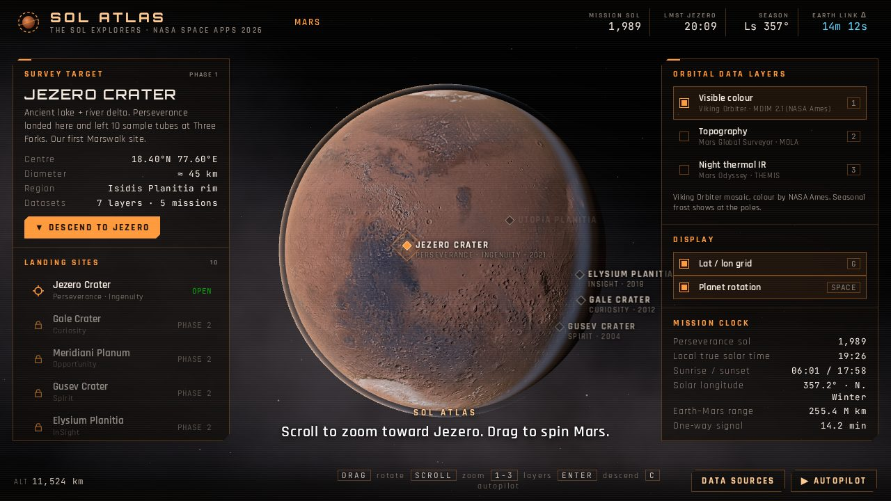

In *The Martian*, Mark Watney survives by doing the maths himself: oxygen, distance, daylight, terrain. Aero Atlas does that maths for the first crews. It stacks data from five NASA missions and ESA's Mars Express on one 3D map, finds the safest route for a walk on foot to any point you pick, and checks whether the astronaut gets home with oxygen to spare. If the plan comes up short, the EVA simulation shows exactly where the suit runs dry. Then you can put on the helmet and walk the real terrain at eye height.

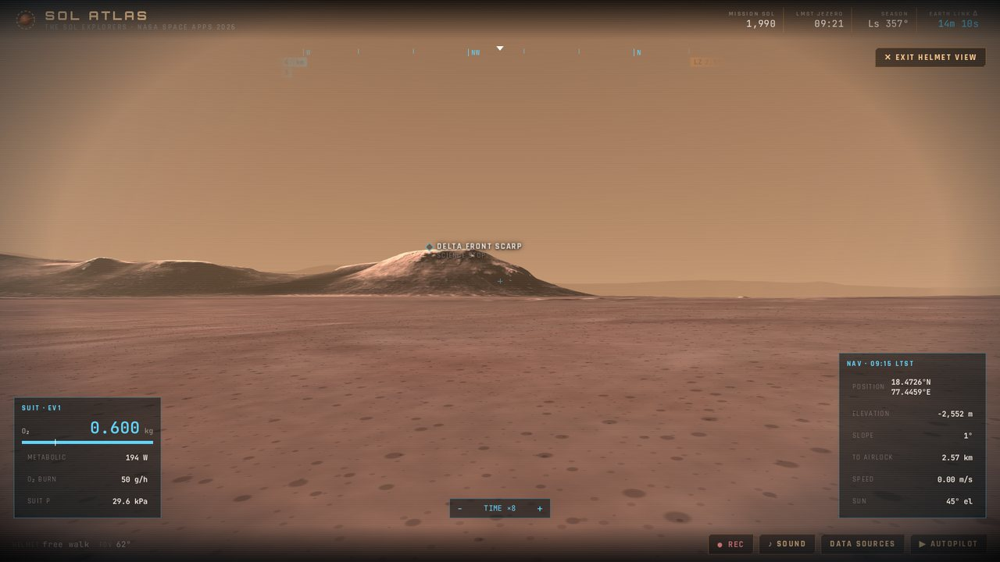

This is the **phase-1 prototype** made for the 240-second local-judging video. Jezero Crater is the only site unlocked; the other landing sites are marked "phase 2".

---

## Contents

- [How it works](#how-it-works)
- [What's new in the polish build](#whats-new-in-the-polish-build)
- [Data layers](#data-layers)
- [The science behind the numbers](#the-science-behind-the-numbers)
- [Places on the map](#places-on-the-map)
- [Controls](#controls)
- [Phones, tablets and performance](#phones-tablets-and-performance)
- [Recording the pitch video](#recording-the-pitch-video)
- [Run it locally](#run-it-locally)
- [Testing and maintenance](#testing-and-maintenance)
- [Dataset sources and processing](#dataset-sources-and-processing)
- [Rebuild the NASA data](#rebuild-the-nasa-data)
- [Deploy](#deploy)
- [Project structure](#project-structure)
- [Limitations and roadmap](#limitations-and-roadmap)
- [AI use disclosure](#ai-use-disclosure)
- [Credits](#credits)
- [Licence](#licence)

---

## How it works

Aero Atlas has three levels. You move between them by scrolling, like zooming from a system map down to a planet surface in a space game.

### 1. Orbit

A rotating Mars with real Viking colour, MOLA relief, a thin dusty atmosphere, Phobos and Deimos. Ten landing sites are marked. Layer `4` lays the **USGS Geologic Map of Mars** (SIM 3292, from the USGS-NASA Planetary Geologic Mapping Program) over the globe; point at any spot to read its rock unit and age. Jezero sits in unit HNt on the rim of the Isidis impact basin, ground more than 3.2 billion years old. Press `Z` (or **Human Exploration Zones** under Display) to show the 38 **Exploration Zones NASA's 2015 workshop proposed for the first human landings**, each with a 100 km radius. Jezero and our Marswalk zone sit inside the *Jezero-Isidis-Syrtis* zone, 51 km from its centre: the site we plan for is one NASA's own human-mission planners put forward. Scroll in and the camera locks onto Jezero; scroll again, or click, to descend. A live mission clock shows the Perseverance sol, local time at Jezero, the Martian season and the current Earth–Mars signal delay.

| Geologic map (layer 4) | NASA's proposed human Exploration Zones (`Z`) |
|---|---|
| 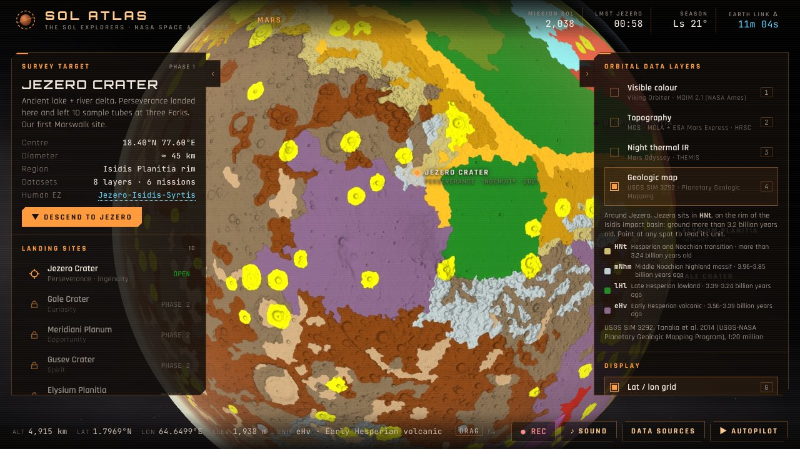 | 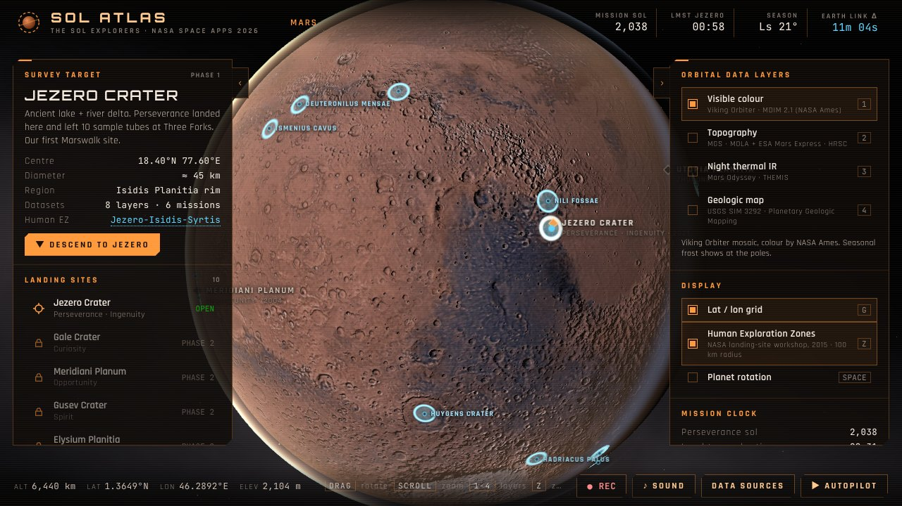 |

### 2. Jezero Crater

The whole crater (89 × 101 km) as a 3D block, built from the orbital imagery and elevation model NASA prepared for Perseverance. The terrain is lit by the real Sun position, with shadows that move as you drag the time-of-day slider.

| Crater | Elevation + contours |
|---|---|
| 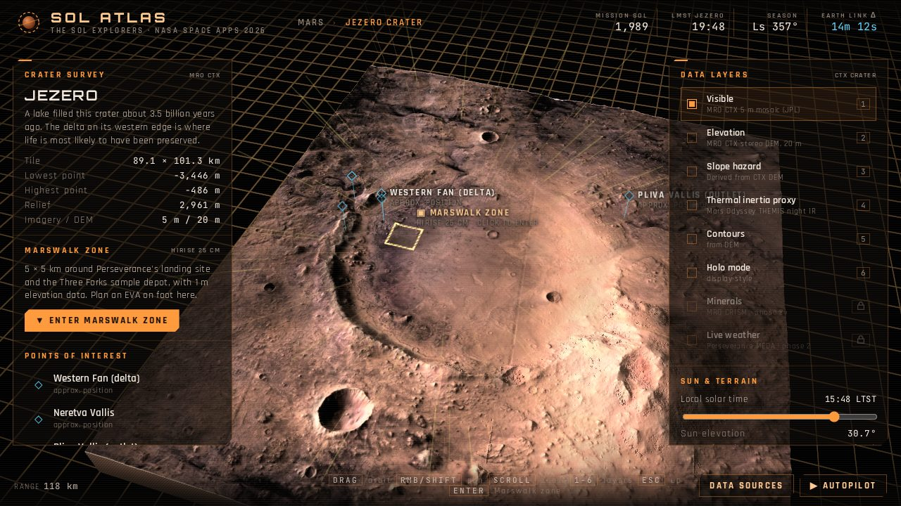 | 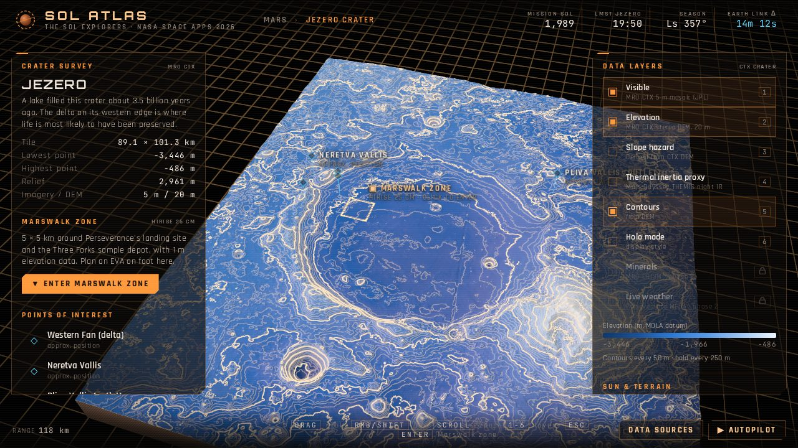 |

The gold line is **Perseverance's real drive path**: 555 end-of-drive positions from NASA/JPL's mission waypoint feed, sol 0 to 2022 (October 2026, 45.25 km). It runs from the landing site, around Séítah, across the delta and up the crater rim. Layer `7` toggles it.

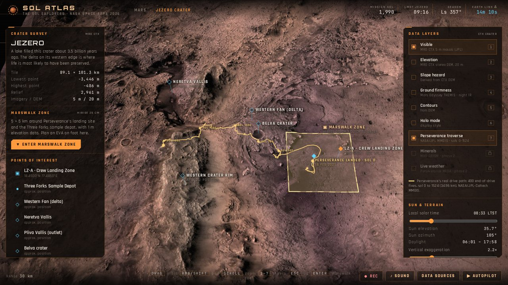

### 3. Marswalk zone

A 6 × 6 km zone around Perseverance's landing site, Séítah, the delta front and the Three Forks sample depot, built from a 25 cm per pixel HiRISE mosaic and a 1 m elevation model. This is where you plan the walk:

- **Start from a science goal.** Pick a mission goal and the plan follows from it: *Bring the samples home* (the Three Forks tubes), *Date the crater floor* (Séítah's olivine bedrock), *Look for signs of ancient life* (the delta front's lake sediments), or the *Grand tour*. Each goal says why this spot answers it, with its source.
- **See it before you go.** Each science stop carries a real Perseverance photo taken at that spot (Navcam or Mastcam-Z raw images), so the crew knows what the place looks like before they arrive. Hover a stop and click its photo, or press PHOTO in the plan: it opens full screen, and ‹ › or the arrow keys step through all the stop photos.
- **Route anywhere, like a maps app.** Click or tap any spot to drop a pin. The card shows its coordinates, elevation, slope class and distance from the airlock. **ROUTE HERE** plans the walk there and back; **ADD STOP** adds it to the plan; **STAND HERE** puts you there in the helmet view.
- **Safest route.** Aero Atlas finds the path that uses the least oxygen while avoiding slopes too steep to walk. A red dashed line shows the straight-line path for comparison.
- **The Watney check.** Distance, EVA time, oxygen used, oxygen left at the airlock, daylight left, the EVA's radiation dose and the storm-shelter time (how long the walk back takes from the farthest point if a solar storm is forecast), ending in **MARSWALK READY**, GO WITH CAUTION or NO-GO.
- **Live space weather at Mars.** When online, the Watney check (and the orbit view's mission clock) asks NASA's **DONKI** service which coronal mass ejections NASA's WSA-ENLIL solar-wind model forecasts to reach Mars. If one is due within three days, or arrived in the last day, it says when, how fast the CME was and links to NASA's forecast, so the crew can keep the walk inside the storm-shelter time. On 13 Nov 2026 it showed a CME forecast to glance Mars at 12:00 UTC that day; the model forecast nine CMEs reaching Mars in the 30 days before. The line is advisory and doesn't change the verdict, and offline it just says "not checked".
- **Rover with a walkback limit.** Switch the plan from ON FOOT to ROVER + WALKBACK and the crew drives between stops on an unpressurised rover. Apollo 15–17 drove under the same rule: never go farther than the crew could walk home if the rover broke down. Aero Atlas checks it along the whole drive and marks the walkback limit in red when a plan breaks it.
- **Point of no return.** If the suit can't carry enough oxygen, a red marker shows the last point where turning back still keeps the reserve.
- **EVA flyover.** Simulate the walk with a chase camera and a wrist display (next stop, oxygen left, dust). The wrist turns amber past the point of no return and red when the reserve is reached. The profile chart follows EV1 as it walks.
- **Where the oxygen runs out.** If the plan needs more O₂ than the suit holds, the planner marks the exact spot and time the tank runs dry, and draws the unreachable rest of the route as red dashes. In the simulation, EV1 stops there and its marker turns red. The wrist display then shows how long a mayday takes to reach Earth (about 14 minutes now) and when the earliest reply could arrive. Nobody on Earth can help in time, so the plan has to be right before the airlock opens.

| Planned route | Point of no return |
|---|---|
| 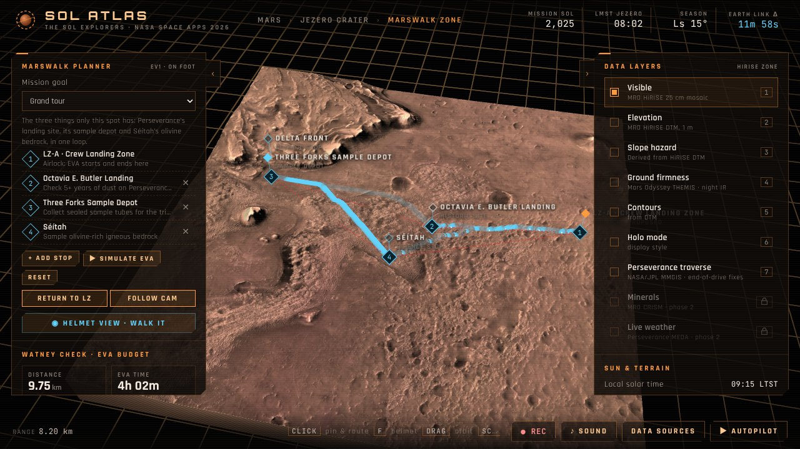 | 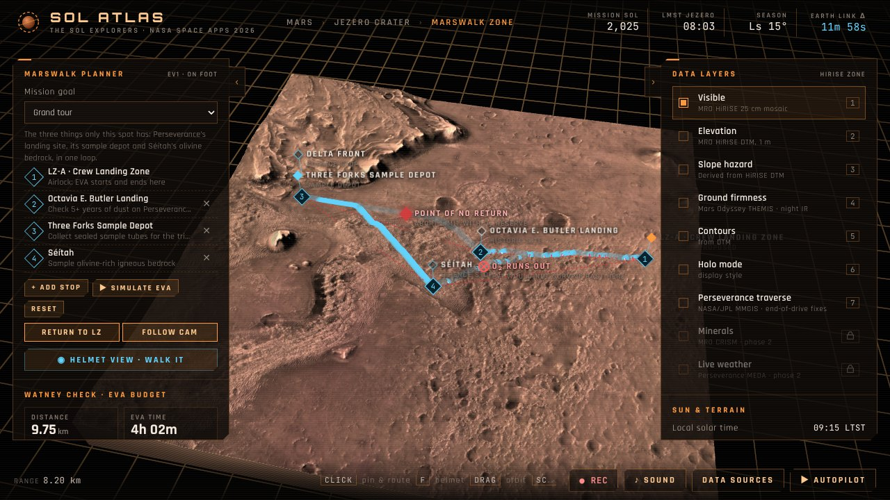 |

| EVA flyover | Slope hazard |
|---|---|
| 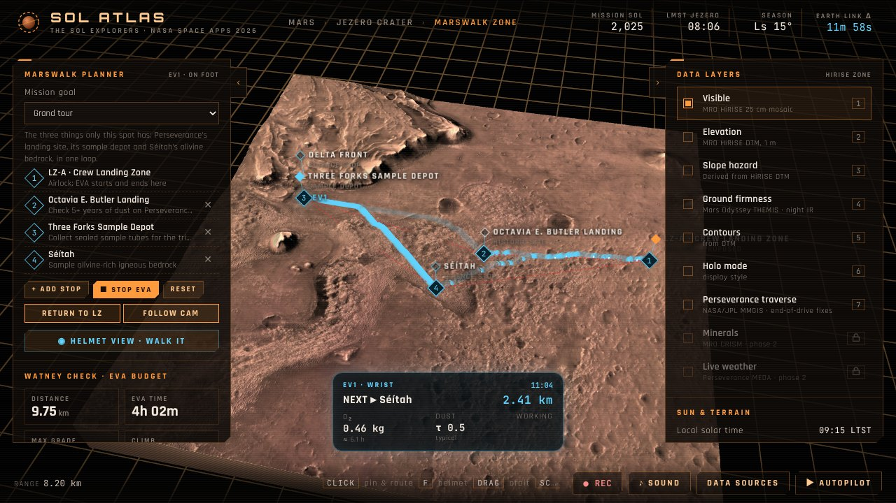 | 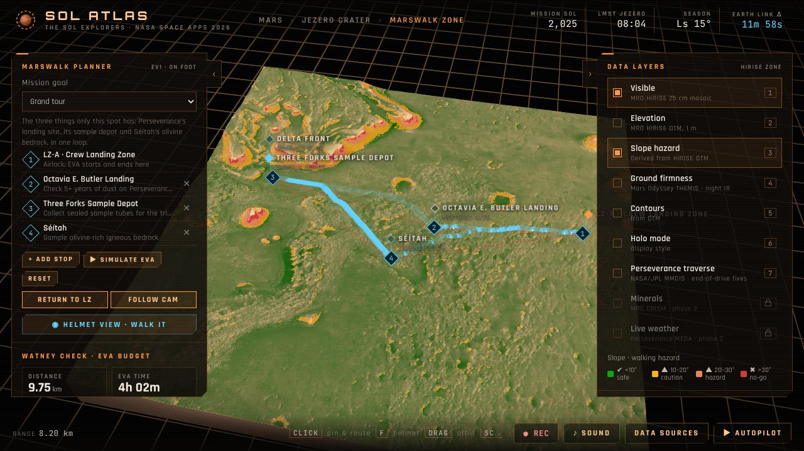 |

| Drop a pin, route there | O₂ runs out: EV1 lost |
|---|---|
| 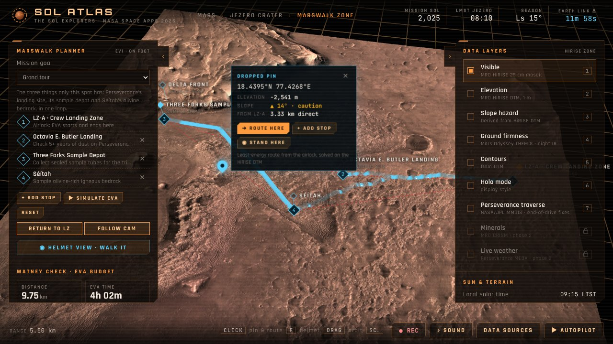 | 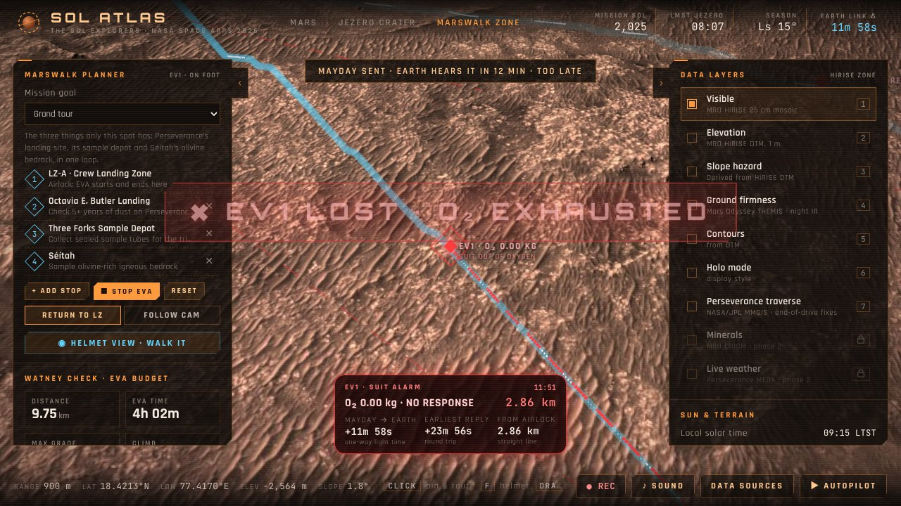 |

### 4. Helmet view

Press **`F`**, **◉ HELMET VIEW**, or **STAND HERE** on a pin to stand on the terrain at 1.8 m eye height, with no vertical exaggeration.

- **Real horizon.** The skyline isn't painted. For every compass bearing, Aero Atlas marches the CTX crater elevation model outward (allowing for the curve of Mars) and keeps the highest angle. The crater rim and the delta sit exactly where they would for someone standing there.
- **Mars sky.** A dusty butterscotch sky with the Sun at its real position for the chosen local time. Around the Sun there is the blue glow Perseverance photographs at sunset, and distant ground fades into haze.
- **The suit is on the clock.** Walking speed follows the slope, and the suit burns O₂ by the same Pandolf metabolic model the planner uses, under a time warp shown on screen. The helmet HUD shows O₂ left, metabolic power, O₂ burn rate, position, slope underfoot and distance to the airlock, plus a compass with bearings to your stops.
- **Overlays still work.** Switch on slope hazard or contours and they paint onto the ground in front of you.
- **Ride along.** Start the EVA simulation in the helmet and you walk the route as EV1. If the plan runs out of oxygen, the view collapses where it happens.

| Slope hazard as a helmet overlay | O₂ exhausted, in the helmet |
|---|---|
| 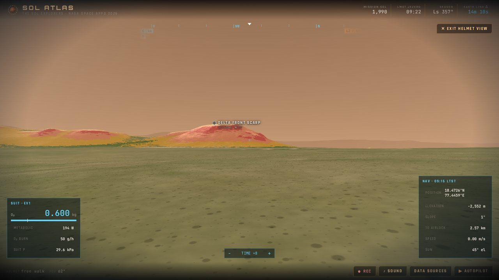 | 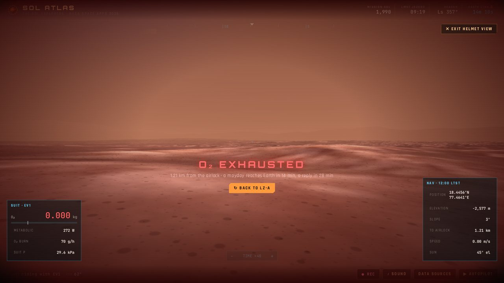 |

---

## What's new in the polish build

| Feature | Why it matters |
|---|---|
| **O₂-exhaustion point** on the route, in the profile and in the simulation | You see *where* a bad plan kills the astronaut, not just that it's NO-GO |
| **Mayday light-time** at the moment O₂ runs out | Shows why Mars crews must plan for themselves: Earth hears the call ~14 min later |
| **Drop a pin, route anywhere** | Plan to any point in the zone, not only named places |
| **Helmet view** with the real skyline | The only first-person view we know of that's built on the actual DTM and horizon |
| **Perseverance's real traverse** | More real mission data: 555 drive fixes over 2,022 sols |
| **Synthesised sound** (♪ / `M`) | Wind, lock-on, alarms, suit breathing. All generated in the browser, no audio files |
| **● REC** (`R`) | Records the tab (HUD and sound included) to a video file for the pitch |

Sound and REC came from ideas in a teammate's early prototype. Its images and several coordinates weren't reusable (AI-generated pictures, approximate positions), so only the ideas were carried over.

---

## Data layers

Every layer is real mission data. Nothing is hand-painted. The exact files, with links, ready to paste into the Space Apps submission form, are in [Dataset sources and processing](#dataset-sources-and-processing).

| Level | Layer | Mission / instrument | Product |
|---|---|---|---|
| Orbit | Visible colour | Viking Orbiters | MDIM 2.1 global mosaic, NASA Ames colour (232 m/px) |
| Orbit | Topography, relief | Mars Global Surveyor · MOLA | MOLA 128/64 ppd merged DEM (463 m/px) |
| Orbit | Night thermal IR | Mars Odyssey · THEMIS | USGS controlled night-IR mosaic (100 m/px) |
| Orbit | Human Exploration Zones (overlay, `Z`) | NASA human landing-site workshop, 2015 | 38 proposed zones, 100 km radius (centres compiled by USGS) |
| Orbit | Geologic map, rock unit and age under the cursor | USGS-NASA Planetary Geologic Mapping Program (mapped on MOLA and THEMIS) | Geologic Map of Mars, USGS SIM 3292 (Tanaka et al. 2014), 1:20 million |
| Orbit, zoomed in on Jezero and Isidis | Relief, elevation colours | **ESA Mars Express · HRSC**, with MGS MOLA | HRSC and MOLA blended DEM v2, 200 m/px (USGS; HRSC data ESA/DLR/FU Berlin) |
| Crater | Visible | MRO · CTX | Mars 2020 Science Investigation CTX orthomosaic, 5 m/px (JPL) |
| Crater | Elevation, slope, contours | MRO · CTX stereo | Mars 2020 Science Investigation CTX DEM, 20 m/px (JPL) |
| Crater + zone | Ground firmness | Mars Odyssey · THEMIS | Night-IR mosaic as a thermal-inertia proxy, 100 m/px |
| Marswalk zone | Visible | MRO · HiRISE | Mars 2020 Terrain-Relative-Navigation orthomosaic, 25 cm/px (USGS) |
| Marswalk zone | Elevation, slope, route | MRO · HiRISE stereo | Mars 2020 TRN DTM, 1 m/px (USGS) |
| Crater + zone | Perseverance traverse | Mars 2020 · rover localisation | NASA/JPL MMGIS "Where is Perseverance?" end-of-drive waypoints, sol 0–2022, from the [MMGIS feed](https://mars.nasa.gov/mmgis-maps/M20/Layers/json/M20_waypoints.json) |
| Marswalk zone | Stop photos | Mars 2020 · Navcam, Mastcam-Z | Raw images from the stops: landing site (sol 16), Three Forks (sol 690), Séítah (sol 249), delta front (sol 502) |
| Helmet view | Skyline | MRO · CTX stereo | Computed from the 20 m crater DEM: highest angle per bearing, Mars curvature included |
| Phase 2 | Minerals | MRO · CRISM | not yet: shown as locked |
| Marswalk zone, orbit clock | Space weather at Mars (live) | NASA DONKI · WSA-ENLIL model (NASA Goddard CCMC) | CME arrival forecasts for Mars over the last 30 days, fetched when the app opens (`api.nasa.gov`) |
| Phase 2 | Live weather | Perseverance · MEDA | not yet: the conditions panel shows typical values, labelled "not live" |

"Ground firmness" works like this: rock and coarse grains stay warm through the night, while dust and fine sand cool fast. So night-time infrared brightness tells firm ground from loose ground.

---

## Dataset sources and processing

NASA map products are obtained through the USGS Astrogeology public `asc-pds-services` archive. Source resolutions differ from the processed display and routing resolutions listed below. These are retained provenance records, not a claim that every external endpoint has been rechecked during documentation cleanup.

### NASA sources

```
- Viking Orbiter 1 & 2: Mars MDIM 2.1 global colour mosaic, recoloured by NASA Ames (232 m/px). Orbit view colour.
  https://asc-pds-services.s3.us-west-2.amazonaws.com/wms_basemaps/Mars/MDIM21_AMESColor/MDIM21_AMES_recolor_dd360_jpeg_cog.tif
- Mars Global Surveyor, MOLA: 128/64 pixels-per-degree merged global elevation model (~463 m). Orbit view relief and elevation colours.
  https://asc-pds-services.s3.us-west-2.amazonaws.com/wms_basemaps/Mars/MOLA/mola128_mola64_merge_90Nto90S_SimpleC_clon0_cog.tif
- Mars Odyssey, THEMIS: night-time infrared controlled mosaic, 100 m, v2 (2018). Night thermal layer and "ground firmness" layer.
  https://asc-pds-services.s3.us-west-2.amazonaws.com/wms_basemaps/Mars/THEMIS_USGS/THEMIS_NightIR_ControlledMosaics_100m_v2_oct2018_cog.tif
- Mars Reconnaissance Orbiter, CTX: Mars 2020 Science Investigation orthomosaic of Jezero Crater, 5 m (NASA/JPL). Crater view imagery.
  https://asc-pds-services.s3.us-west-2.amazonaws.com/mosaic/mars2020_trn/CTX/ScienceInvestigationMaps_JPL/M20_JezeroCrater_CTXortho_mosaic_5m.tif
- Mars Reconnaissance Orbiter, CTX stereo: Mars 2020 Science Investigation elevation model of Jezero, 20 m (NASA/JPL). Crater 3D terrain, slope, contours.
  https://asc-pds-services.s3.us-west-2.amazonaws.com/mosaic/mars2020_trn/CTX/ScienceInvestigationMaps_JPL/M20_JezeroCrater_CTXDEM_20m.tif
- Mars Reconnaissance Orbiter, HiRISE: Mars 2020 Terrain-Relative-Navigation orthomosaic of the landing site, 25 cm. Marswalk zone imagery.
  https://asc-pds-services.s3.us-west-2.amazonaws.com/mosaic/mars2020_trn/HiRISE/JEZ_hirise_soc_007_orthoMosaic_25cm_Ortho_blend120.tif
- Mars Reconnaissance Orbiter, HiRISE stereo: Mars 2020 Terrain-Relative-Navigation elevation model, 1 m. Marswalk zone 3D terrain, slope, route finding, elevation profile.
  https://asc-pds-services.s3.us-west-2.amazonaws.com/mosaic/mars2020_trn/HiRISE/JEZ_hirise_soc_006_DTM_MOLAtopography_DeltaGeoid_1m_Eqc_latTs0_lon0_blend40.tif
- Mars 2020 Perseverance: rover end-of-drive positions from NASA/JPL's "Where is Perseverance?" map (MMGIS waypoint feed), sol 0 to 2022 (October 2026). Perseverance traverse layer.
  https://mars.nasa.gov/mmgis-maps/M20/Layers/json/M20_waypoints.json
- Mars 2020 Perseverance: landing site (Octavia E. Butler Landing, 18 Feb 2021), and the rover's positions at Séítah (sols 248–278) and the delta front (sols 477–502), from the waypoint feed above. Science stops in the Marswalk zone.
- Mars 2020 Perseverance raw images (Navcam and Mastcam-Z), one per science stop, taken at that spot: landing site sol 16, Three Forks sol 690, Séítah sol 249, delta front sol 502. Shown as "what you'll see" photos. Credit NASA/JPL-Caltech (Mastcam-Z: NASA/JPL-Caltech/ASU).
  https://mars.nasa.gov/mars2020/multimedia/raw-images/
- Mars 2020 Three Forks Depot bundle (NASA PDS Geosciences Node): rover latitude, longitude and elevation at each of the 10 sample-tube drops, and the sample IDs. Three Forks stop position, and the elevation check (−2,545 m).
  https://pds-geosciences.wustl.edu/m2020/urn-nasa-pds-mars2020_sample_depot_three_forks/
- USGS-NASA Planetary Geologic Mapping Program: Geologic Map of Mars, USGS Scientific Investigations Map 3292 (Tanaka et al. 2014), 1:20,000,000, mapped on MGS MOLA and Mars Odyssey THEMIS data. The globe's "Geologic map" layer (the map's own colours) and the rock unit and age shown under the cursor.
  https://asc-pds-services.s3.us-west-2.amazonaws.com/pigpen/mars/geology/SIM3292_newGlobalGeology2014/SIM3292_MarsGlobalGeologicGIS_20M_raster.zip
  https://asc-pds-services.s3.us-west-2.amazonaws.com/pigpen/mars/geology/SIM3292_forJMars/sim3292_MarsGeologicMap_JMars_64ppd.zip
  https://doi.org/10.3133/sim3292
- NASA First Landing Site / Exploration Zone Workshop for Human Missions to the Surface of Mars (Oct 2015): the 38 proposed Exploration Zones (100 km radius), centre points compiled by USGS from JMARS. Shown as rings on the globe (Display → Human Exploration Zones, key Z). Jezero and the Marswalk zone lie inside the "Jezero-Isidis-Syrtis" zone, 51 km from its centre.
  https://asc-pds-services.s3.us-west-2.amazonaws.com/pigpen/mars/Human_EZs/Human_ExplorationZones_Proposed_Oct2015.zip
- NASA GISS Mars24 sunclock algorithm (Allison & McEwen 2000): Mars time, sols, local solar time, Sun position.
  https://www.giss.nasa.gov/tools/mars24/help/algorithm.html
- NASA JPL Solar System Dynamics, "Approximate Positions of the Planets" (Standish): Earth–Mars distance and signal delay.
  https://ssd.jpl.nasa.gov/planets/approx_pos.html
- NASA DONKI (Space Weather Database Of Notifications, Knowledge, Information; Community Coordinated Modeling Center, NASA Goddard), via the NASA API portal: WSA-ENLIL CME simulations for the last 30 days, fetched live when the app opens. The Watney check and the mission clock show any CME forecast to reach Mars within three days (advisory). On 13 Nov 2026: a 726 km/s CME launched 9 Nov, forecast to glance Mars at 12:00 UTC on 13 Nov; nine CMEs forecast to reach Mars in the 30 days before.
  https://api.nasa.gov (DONKI → WSAEnlilSimulations)
- Published NASA mission results used as typical values (labelled "not live" in the app): Perseverance MEDA weather ranges; Curiosity RAD surface radiation dose (Hassler et al. 2014, Science).
```

### Space agency partner and other sources

```
- ESA Mars Express, HRSC (High Resolution Stereo Camera; ESA/DLR/FU Berlin): elevation models of the Jezero and Isidis region, used through the USGS "Mars HRSC MOLA Blended DEM Global 200m v2" (Fergason, Hare & Laura 2018), which merges HRSC stereo DTMs with NASA's MOLA. Relief and elevation colours on the globe when zoomed in on Jezero (200 m instead of MOLA's 463 m).
  https://asc-pds-services.s3.us-west-2.amazonaws.com/mosaic/Mars/HRSC_MOLA_Blend/Mars_HRSC_MOLA_BlendDEM_Global_200mp_v2.tif
- U.S. Geological Survey (USGS) Astrogeology Science Center: processed, controlled and archived the NASA maps above (CTX and HiRISE mosaics and elevation models, the THEMIS controlled mosaic), served from its public "asc-pds-services" archive on AWS.
- Scientific references: Pandolf, Givoni & Goldman (1977), load-carriage metabolic equation, used for the EVA oxygen model; Tobler's hiking function (walking speed vs slope); Mangold et al. (2021), Science, Jezero delta geology.
- Software: three.js (MIT licence), Vite (MIT). Python: rasterio, NumPy, Pillow, SciPy. Fonts: Rajdhani, Orbitron, JetBrains Mono (SIL Open Font Licence, via Fontsource).
- AI tools: Claude Code (Anthropic); OpenAI Codex assisted with repository documentation cleanup. Claude Code wrote the code and documentation under the team's direction. See the AI use disclosure section of this README.
- Our own assumptions (labelled in the app): proposed crew landing zone LZ-A, suit oxygen capacity 0.60 kg with a 25 % reserve, 20° walking-slope limit, approximate positions of some named places.
```

---

### Dataset processing

| App feature | NASA data | Processing (in `scripts/build_data.py`) |
|---|---|---|
| Globe colour | Viking MDIM 2.1 (NASA Ames colour) | Resampled to 2k / 4k / 8k by device |
| Regional relief around Jezero and Isidis | ESA Mars Express HRSC + MGS MOLA blended DEM, 200 m (USGS) | 12° × 12° window read at full resolution, averaged to 2048², normal map and elevation ramp |
| Globe relief, elevation colours | MGS MOLA 128/64 ppd DEM | Normal map (relief ×18), blue elevation ramp, 1024 × 512 elevation grid for readouts |
| Globe geologic map, unit readout | USGS SIM 3292 Geologic Map of Mars (USGS-NASA Planetary Geologic Mapping Program) | `geology` stage: official 64 ppd colour map → 4096 × 2048; coded 32 ppd unit raster → 2880 × 1440 lookup grid (`g_geo_units.png`); each unit's colour and symbol in `manifest.json`. Names and ages from the map's legend and pamphlet Table 1 (`src/data/geology.js`) |
| Human Exploration Zones on the globe | NASA 2015 human landing-site workshop (USGS compilation) | `zones` stage: the 38 primary zone centres (alternate centres dropped) into `manifest.json` → `zones`; drawn in the globe shader as 100 km rings |
| Night thermal / ground firmness | Mars Odyssey THEMIS night IR 100 m | Clipped to ±54° (streaky edges), gentle contrast curve, orange ramp |
| Crater imagery | MRO CTX 5 m orthomosaic (JPL) | 4096 × 4658 px (~22 m/px), tinted with the Viking colour of the same ground |
| Crater terrain, slope, contours | MRO CTX 20 m DEM (JPL) | 1024 × 1164 height grid; slope from the full 20 m DEM |
| Marswalk zone imagery | MRO HiRISE 25 cm TRN orthomosaic | 6 × 6 km cut, 4096² px (~1.5 m/px), seams flattened, tinted |
| Marswalk zone terrain, slope, routes, profile | MRO HiRISE 1 m TRN DTM | 1024² height grid; slope at 2.9 m; A* route grid 512² |
| Space weather at Mars (live) | NASA DONKI WSA-ENLIL simulations (api.nasa.gov) | Not stored. `src/lib/spaceweather.js` fetches the latest runs directly from NASA DONKI (DEMO_KEY) and keeps the latest forecast per CME with a Mars entry in `impactList` |
| Perseverance traverse | Mars 2020 end-of-drive waypoints (NASA/JPL MMGIS) | 555 points (last fix of each sol), sol 0–2022, stored in `public/data/m20_traverse.json` by the `traverse` stage |

### Unused datasets and coverage limitations

- **Minerals:** the MRO CRISM archive (NASA PDS) would fill the locked "Minerals" layer.
- **Minerals, checked 13 Nov 2026:** the USGS bucket has CRISM summary mosaics made for the human Exploration Zones (`pigpen/mars/Human_EZs/CRISM_MTRDRs`), but only two scenes touch Jezero (FRT00005850 and FRT000066A4, 2007). They cover the southern and eastern crater floor, miss the delta, Three Forks and Séítah, and their mineral browse products show almost no signal there. Not used: a layer from them would look like noise. The well-known Jezero delta scenes are on the PDS Geosciences Node (ODE), not reachable from the build machine.
- **Weather:** Perseverance MEDA data is published on NASA's PDS Atmospheres Node, months after collection. There is no live public feed, so the app shows typical values labelled "not live".

---

## The science behind the numbers

| Feature | How it's calculated | Checked against |
|---|---|---|
| Mars clock | NASA GISS **Mars24** algorithm (Allison & McEwen 2000) | Mars24 reference date; Perseverance landing = sol 0 |
| Earth–Mars signal delay | JPL approximate planetary positions (Keplerian elements, 1800–2050) | 11 min 22 s on landing day, 18 Feb 2021, matching NASA's figure |
| Sun and shadows | Solar declination and hour angle for Jezero; shadows ray-marched through the elevation model on the GPU | Sunrise and sunset shown in the HUD |
| Safest route | A* search on a 512 × 512 grid from the HiRISE DTM. Step cost is **metabolic energy**, so the route minimises oxygen; cells steeper than the walking limit are avoided | Default loop solves in under 40 ms |
| Walking cost | **Pandolf et al. (1977)** load-carriage equation, scaled to Mars gravity (0.38 g) with a pressure-suit penalty; Tobler-style speed vs. grade; 1 L O₂ ≈ 20.1 kJ | Flat walking at 0.9 m/s ≈ 293 W ≈ 0.075 kg O₂ per hour, the same rate our 0.60 kg / 8 h suit assumption is sized on |
| Point of no return | First point on the way out where O₂ used so far + O₂ to walk straight back (plus a 25 % detour allowance) would eat into the reserve | Default loop: 0.30 kg suit → PNR at 3.92 km, 0.25 kg → 3.23 km (both on the leg to Three Forks) |
| O₂ runs out | The EVA's walk/stop timeline carries cumulative O₂; the first moment it reaches the tank size gives the time and place | 0.20 kg suit on the default loop: O₂ out at 6.38 km, 2 h 41 min in, 2.86 km from the airlock |
| Rover and walkback | Rover legs at 5 km/h with the crew seated (150 W). The walkback check is the point-of-no-return test applied to the whole drive, home leg included: O₂ used so far + O₂ to walk straight home (25 % detour allowance) must stay above the reserve | Default loop with a 0.30 kg suit: NO-GO on foot (PNR at 3.92 km), READY by rover (closest call 0.19 of 0.23 kg). With 0.20 kg: walkback limit at 3.90 km |
| Radiation dose | EVA time × the surface dose rate Curiosity's RAD measured, 0.64 mSv per day (Hassler et al. 2014). A suit adds little shielding against cosmic rays | Default loop: ≈ 0.11 mSv, against NASA's 600 mSv career limit |
| Storm shelter | Longest straight walk back to the airlock from any point on the route, at flat walking speed with the PNR's 25 % detour allowance: how long the crew is exposed if a solar-storm warning comes in | Default loop: ≤ 1 h 40 min, worst at Three Forks (4.61 km) |
| Mayday delay | One-way and round-trip light time from the same Earth–Mars model as the header clock | ~14 min one way on 25 Sep 2026 |
| Helmet skyline | For each of 360 bearings, march the CTX DEM from 2.6 to 46 km and keep the highest elevation angle, after subtracting the curvature drop d²/2R | Highest skyline 4.5° toward bearing 263° (the western rim and delta) |
| Elevations | Heights decoded from the DEMs | Three Forks: −2,545 m in the HiRISE DTM vs −2,545.3 m rover elevation at the tube drops in NASA's PDS depot archive |

Default EVA assumptions, all editable in the planner: 75 kg astronaut, 58 kg suit and backpack, no extra science kit (0–30 kg slider, added to the load in the walking model: 20 kg raises the default loop from 0.30 to 0.38 kg of O₂), 0.60 kg usable O₂ (about 8 h), 25 % reserve, 20° walking-slope limit, 20 min per science stop.

The default plan (LZ-A → Octavia E. Butler Landing → Three Forks → Séítah → LZ-A) comes out at **9.75 km, 4 h 02 min, 0.30 kg of O₂, 50 % margin: MARSWALK READY**.

| Mission goal | Stops (from and back to LZ-A) | Route | O₂ | Call |
|---|---|---|---|---|
| Grand tour | Landing site, Three Forks, Séítah | 9.75 km | 0.30 kg | READY |
| Bring the samples home | Three Forks | 8.74 km | 0.24 kg | READY |
| Date the crater floor | Séítah | 5.46 km | 0.16 kg | READY |
| Look for signs of ancient life | Delta front | 9.30 km | 0.26 kg | CAUTION (steep sections up to 17° on the delta) |

---

## Places on the map

| Place | Position | Notes |
|---|---|---|
| Octavia E. Butler Landing | 18.4447°N 77.4508°E | Perseverance touchdown, 18 Feb 2021 |
| Three Forks Sample Depot | 18.4528°N 77.4082°E | 10 sample tubes laid sols 653–690 (Dec 2022 – Jan 2023) at the foot of the delta. Mean of the rover positions at each tube drop, from NASA's PDS Three Forks Depot archive |
| Séítah | 18.4339°N 77.4430°E | Where Perseverance parked on Séítah's edge, sols 248–278, and cored Coulettes (sol 271). NASA/JPL MMGIS waypoints |
| Delta front | 18.4589°N 77.4061°E | Where Perseverance parked on the delta front, sols 477–502, and cored Skyland (sol 495). NASA/JPL MMGIS waypoints |
| LZ-A, crew landing zone | 18.4500°N 77.4850°E | **Our proposal**, not a NASA site: flat lava floor, over 4 km from the depot so engine blast can't reach it |
| Western Fan (delta), Belva crater, Neretva Vallis, Pliva Vallis, crater rim | approx. | Crater-view labels, placed by eye on the CTX mosaic |
| Acidalia Planitia "Ares III" | 31.2°N 28.5°W | Fiction: Mark Watney's base in *The Martian* (Andy Weir) |

---

## Controls

| | Orbit | Crater / Marswalk zone |
|---|---|---|
| Drag | spin the planet | orbit the camera |
| Right-drag or Shift-drag | | pan |
| Scroll | zoom; locks onto Jezero when close | zoom toward the cursor. Keep scrolling out to go up a level |
| Click | Jezero, or the lock-on, to descend | the Marswalk zone to enter it. In the zone, click anywhere to **drop a pin** (ROUTE HERE / ADD STOP / STAND HERE), or click a named place to add it as a stop |
| Keys | `1`–`4` layers · `Z` Exploration Zones · `G` grid · `Space` rotation · `Enter` descend | `1`–`7` layers · `WASD` pan · `Enter` enter zone · `Esc` go up · `Space` run the EVA simulation · `F` helmet view |
| Anywhere | `C` autopilot · `H` hide HUD · `K` captions on/off · `M` sound · `R` record | |
| Touch | drag to spin · pinch to zoom · tap Jezero to descend | drag to orbit · pinch to zoom · two-finger drag to pan · tap to select |

**Helmet view:** drag to look · `WASD` / arrows to walk (`Shift` = faster) · `Q`/`E` turn · click or tap a spot to walk there · scroll or pinch to zoom · `[` `]` or the − / + buttons change the time warp · `Esc` or `F` to leave.

**Helmet view on phones:** turn the phone sideways (on Android it goes fullscreen and locks to landscape). The **left stick walks**: a light push is a slow walk, full push jogs. The **right stick looks around**. You can still tap a spot to walk there.

On desktop, each side panel has a small **‹ / ›** tab on its inner edge that tucks it away; the tab stays at the screen edge to bring it back, and the choice is remembered.

On phones and upright tablets, the side panels open as a sheet from the tabs at the bottom of the screen (**JEZERO / CRATER / PLANNER** and **LAYERS**). Tap the map to close the sheet.

---

## Phones, tablets and performance

Aero Atlas picks a quality level for each device when it loads. You can force one by adding it to the URL:

| Level | Chosen for | What changes | Force it with |
|---|---|---|---|
| High | desktops and laptops | 8k globe, full-resolution terrain, up to 2× sharpness | `?q=high` |
| Medium | tablets, 4-core or low-memory laptops | 4k globe, full terrain, up to 1.5× sharpness | `?q=medium` |
| Low | phones | half-resolution textures (about 11 MB download instead of 40 MB), terrain meshes with 4× fewer points, 30 fps cap, no screen overlays | `?q=low` |

On every level:
- **Adaptive resolution** lowers the render resolution when frames get slow and raises it again when there's headroom.
- **Shadows** are baked into a texture only when the sun or the relief changes, instead of being re-calculated for every pixel on every frame.
- Everything is decoded, compiled and uploaded behind the loading screen, so the zoom transitions never stall on first use.

---

## Recording the pitch video

Press **`C`** (or **▶ AUTOPILOT**) for a scripted fly-through of about two minutes, with captions. It follows the WHAT and SO WHAT sections of our pitch script:

1. Orbit, then the MOLA, THEMIS and geologic-map layers, and NASA's proposed human Exploration Zones (Jezero sits inside one).
2. Lock onto Jezero and descend.
3. Crater: elevation and contours, ground firmness, slope hazard.
4. Marswalk zone: the safest route.
5. Perseverance's real drive path across the crater.
6. "What if the suit carried only 0.20 kg of O₂?" The point of no return appears and the call is NO-GO. "And if they walk anyway?" EV1 stops in red where the O₂ runs out, and the mayday light-time appears.
7. EVA flyover with the wrist display.
8. Pick Three Forks: the route draws and **MARSWALK READY** shows.
9. Holo-mode end card.

Tips:
- Press `K` to hide the captions if you're recording your own voiceover, and `H` to hide the HUD for clean B-roll.
- **■ STOP AUTOPILOT** (dimmed during the run), `Esc`, or any click or scroll on the map hands control back to you. Stopping puts back whatever the autopilot changed (O₂ setting, layers, plan).
- **Built-in recorder:** press **● REC** (or `R`), choose *this tab* and allow audio, then press `C`. The controls hide during the autopilot, so the take is clean. Press `R` again (or the browser's *Stop sharing*) and a `.webm` downloads. Desktop Chrome or Edge works best.
- Or record at 1920 × 1080 with OBS, or with the Xbox Game Bar (`Win + Alt + R`).

---

## Run it locally

You need [Node.js](https://nodejs.org) 20 or newer and a desktop browser with a graphics card (Chrome, Edge or Firefox).

```bash
git clone https://github.com/ayankrmondal2003-rgb/AeroAtlas
cd AeroAtlas
npm install
npm run dev          # opens http://localhost:5173
```

The processed NASA data is already in the repo (`public/data/`, about 40 MB), so you don't need Python to run the app.

Quality is picked automatically; see [Phones, tablets and performance](#phones-tablets-and-performance) to force a level.

Production build:

```bash
npm run build        # static site in dist/
npm run preview      # serve dist/ at http://localhost:4173
```

---

## Testing and maintenance

The smoke test requires Playwright and its Chromium browser, available to Node. Build with `npm run build`, then keep `npm run preview -- --port 4173` running in a separate terminal. In PowerShell, with Playwright installed globally:

```powershell
$env:NODE_PATH = npm root -g
node scripts/smoke.cjs
$env:DEVICE = "iPhone 14"
node scripts/smoke.cjs
Remove-Item Env:DEVICE
```

The test uses software WebGL and stubs NASA DONKI requests; real phone/GPU testing is still needed for frame rate, touch controls and landscape behavior. Recording needs a real browser tab-capture session. Do not repeatedly call the live NASA API from automated tests.

`src/main.js` owns transitions between orbit, crater and site scenes. Terrain scenes use kilometres; orbit uses a planet radius of 1. Feature switches are in `src/config.js`. In the browser console, `window.solAtlas` exposes the application for debugging.

Maintenance details that prevent regressions:

- Data URLs use the hash-aware loader in `src/core/assets.js`; preserve cache invalidation when updating processed maps.
- Height PNGs encode 16-bit heights in red and green; ImageBitmap textures are already flipped during decoding.
- Build interactive DOM elements once rather than replacing them every frame. Labels create stacking contexts, so overlays need the correct parent z-index.
- Bake terrain shadows only when lighting or exaggeration changes. Keep per-frame work allocation-free where possible.
- The helmet view uses a 0.0018 km eye height and 0.0004 km near plane; map and helmet route lifts differ.
- Autopilot changes must be restored on stop, and transitions awaited so cancellation takes effect promptly.

---

## Rebuild the NASA data

`scripts/build_data.py` downloads the source data from the public USGS Astrogeology archive (`asc-pds-services` on AWS S3) and bakes the textures and heightmaps in `public/data/`. It streams only the parts it needs. For example, the largest source is a 3.4 GB HiRISE mosaic, and the script reads just the 6 × 6 km zone.

```bash
pip install rasterio numpy pillow scipy
npm run data                           # everything (a few minutes)
python3 scripts/build_data.py crater   # or one stage: global | region | crater | site | lite
```

Downloads are cached in `.cache/`, which is git-ignored. The `lite` stage writes the half-resolution phone textures to `public/data/lite/` and a 4k globe map for medium-quality devices. Heightmaps are stored as PNG images: each 16-bit height is split across the red and green channels (height = R × 256 + G), so any static web host can serve them without loss.

---

## Deploy to Render

The site is configured for **[Render](https://render.com/)** using [`render.yaml`](render.yaml) as a high-performance **Static Site** (free hosting with global CDN, custom domains, and automatic SSL).

### Option 1: Deploy with Render Blueprint (Recommended)

1. Push your repository to GitHub (`main` branch).
2. Go to the [Render Dashboard](https://dashboard.render.com).
3. Click **New +** -> **Blueprint**.
4. Connect your GitHub repository (`AeroAtlas`).
5. Render will automatically detect `render.yaml` and configure the Static Site:
   - **Type:** Static Site
   - **Build Command:** `npm install && npm run build`
   - **Publish Directory:** `dist`
   - **Node Version:** `22` (defined via `.node-version` and `render.yaml`)
6. Click **Apply**. Render will build and deploy your site to an active `*.onrender.com` URL.

### Option 2: Manual Static Site Setup on Render

1. Go to [Render Dashboard](https://dashboard.render.com) -> **New +** -> **Static Site**.
2. Connect your GitHub repository.
3. Configure the settings:
   - **Name:** `aeroatlas` (or your chosen name)
   - **Branch:** `main`
   - **Root Directory:** (leave blank if repo root, or `AeroAtlas` if in a subfolder)
   - **Build Command:** `npm install && npm run build`
   - **Publish Directory:** `dist`
4. Under **Redirects/Rewrites**:
   - Add a rewrite rule: Source `/*` -> Destination `/index.html` (Action: `Rewrite`).
5. Click **Create Static Site**.

`dist/` also works on GitHub Pages or any other static host, because all asset and data paths are relative.

---

## Project structure

```
index.html              HUD skeleton (panels, loader, overlays)
render.yaml             Render Blueprint configuration (build, publish, headers, SPA rewrite)
.node-version           Node.js runtime version for Render (Node 22)
vite.config.js          Vite config (relative base path)
src/
  main.js               app: level transitions (orbit ⇄ crater ⇄ zone), input, render loop
  styles.css            HUD styling
  orbit/                Mars globe: planet shader (layers, zoom-in detail, relief, lock-on rings),
                        atmosphere, moons, stars
  terrain/              TerrainView: 3D terrain, layer shader, GPU shadows, contours, holo mode, traverse, camera
                        Planner: stops, A* routes, EVA budget, point of no return, O₂-out point, EVA flyover
                        FirstPerson: helmet view (sky, real skyline, walking, suit HUD, ride-along)
                        Pin: drop a pin, route here / add stop / stand here
                        pathfinding.js (A*), eva.js (metabolic + O₂ model)
  ui/                   HUD panels and legends, elevation-profile chart, labels pinned to 3D points,
                        sound.js (Web Audio synth), recorder.js (tab → video)
  lib/                  marstime.js (Mars24, signal delay, sun position), geo.js,
                        spaceweather.js (live CME forecasts for Mars from NASA DONKI)
  core/                 asset loader, quality levels + adaptive resolution, scene crossfade, autopilot
  data/places.js        landing sites, points of interest, default Marswalk plan
  data/geology.js       USGS SIM 3292 unit names, ages and descriptions
scripts/build_data.py   NASA/USGS → web data pipeline
public/data/            processed textures + heightmaps + manifest.json (lite/ = phone versions),
                        m20_traverse.json (Perseverance end-of-drive waypoints, sol 0–2022)
docs/screenshots/       images used in this README
scripts/smoke.cjs       Playwright smoke test (desktop or DEVICE="iPhone 14")
```

---

## Limitations and roadmap

**Known limitations in phase 1**
- Only Jezero is unlocked.
- The CRISM mineral layer and live MEDA weather aren't in yet.
- Some place positions are approximate (see [Places](#places-on-the-map)).
- Routing does not model individual boulders below the routing grid resolution; rock roughness hazards and two-person EVA remain future work. Thermal brightness is a ground-firmness proxy, not a direct bearing-strength measurement.
- The EVA model is a planning estimate, not flight-certified. Its assumptions are listed in the planner.
- The helmet view's close-up pebbles and grain are procedural. HiRISE resolves 25 cm, so anything smaller is decoration, and the terrain mesh is sampled every ~5 m.
- The traverse is a snapshot of NASA's feed (sol 2022, October 2026; on 13 Nov 2026 the feed still ended there). `python3 scripts/build_data.py traverse` refreshes it.
- Space weather is a forecast for Mars as a whole, from NASA's model. It does not include solar particle events measured at Mars.

**Next**
- More sites, including ice-rich plains from NASA's SWIM ice-mapping project.
- CRISM minerals.
- Live MEDA weather.
- Dust-storm alerts from orbit. Space-weather alerts for CMEs are in (NASA DONKI); solar energetic particle alerts would be the next step.
- An offline mode for suits and rovers.

---

## AI use disclosure

The following records AI assistance in the project originally developed as Sol Atlas.

### What AI was used for

| Part of the project | AI involvement |
|---|---|
| **Application code** (JavaScript, GLSL shaders, HTML, CSS in `src/` and `index.html`) | Written by an AI coding assistant, **Claude Code (Anthropic)**, following the team's instructions. The team set the goals and features, tested each version, and asked for fixes. |
| **Data-processing pipeline** (`scripts/build_data.py`) | Written by the AI assistant, which also ran it to convert the NASA files. The pipeline only resamples, crops and colour-maps NASA data; it does not invent values. |
| **Test scripts** (`scripts/smoke.cjs`) | Written by the AI assistant. |
| **Documentation** (README, historical development documents, the in-app text and place descriptions) | Drafted by the AI assistant. The place descriptions summarise the published sources cited next to them. |
| **Pitch script and background research** | Drafted with the help of an AI assistant (Claude). |

### Why we used AI

A working 3D map on real NASA data is a lot of code for a student team in a short time. The AI assistant wrote that code, so the team's own time went into what the project is about: the survival question we answer (will the astronaut get home with oxygen to spare?), choosing the NASA data, the planning rules, and testing on our own phones and computers.

### The prompts we gave

The assistant worked from plain-language requests by the team, given over several sessions. The main requests included:

| Date | What we asked for (summarised) | What the AI worked on |
|---|---|---|
| 24 Sep 2026 | Build *Sol Atlas* from our pitch script: a rotating real-data Mars, zoom into Jezero Crater, then a game-style map where you plan a walk from a landing zone to the Three Forks sample depot and check the oxygen. Use real NASA data only. | NASA/USGS map files (Viking, MOLA, THEMIS, CTX, HiRISE), our pitch script |
| 24 Sep 2026 | The desktop lags in transitions and the phone freezes; make it run on phones and fix the phone layout. | The app code |
| 25 Sep 2026 | Review a teammate's prototype and take anything good; add more real data; make EV1 stop where the oxygen runs out; route to any point, like a maps app; add a first-person view; push each feature when it is done. | The teammate's prototype code, the Perseverance waypoint archive |
| 25 Sep 2026 | Fix the bugs we found in testing (autopilot would not stop, hidden hover cards, dead buttons), make the helmet view work on phones with joysticks, and keep a record another person or AI can pick up. | The app code, our bug reports |
| 28 Sep 2026 | Is all the data real and reliable? Is there newer data? Are we following NASA's guidelines? | Space Apps rules (via web search), the data links |
| 29 Oct 2026 | Check the project against the Participants Guide and the challenge, and do what is needed. | The Bangladesh Participants Guide, a build guide for the 14 challenges |

### Where our own work went

- **The idea and the story:** the survival question, the *Martian* hook, Jezero as the site and the walk to Three Forks came from our pitch script.
- **The choices:** which datasets to use, the suit and walking assumptions, the proposed crew landing zone LZ-A, what to show and what to cut, and when to hide a feature.
- **Testing and review:** we ran every build on our own computers and phones, reported the bugs, and decided whether each fix was right.
- **The pitch and the videos:** the script was drafted with AI help (see the table above), but we edit it, present it and record the videos ourselves.

### What is not AI-generated

- **Map data comes from NASA missions and ESA Mars Express HRSC (ESA/DLR/FU Berlin)**: Viking, Mars Global Surveyor MOLA, Mars Odyssey THEMIS, MRO CTX, MRO HiRISE and Mars 2020 Perseverance. The full list, with the exact files, is in [Dataset sources and processing](#dataset-sources-and-processing). No terrain, image or measurement in the app was produced by an AI model.
- **No AI-generated images, video or audio** are used anywhere in the app or the repository. The screenshots in `docs/screenshots/` are captures of the running app, which renders the NASA data. The sound effects are generated live by ordinary code (Web Audio oscillators and filtered noise), not by an AI audio model.
- **The app calls no AI service at runtime.** Its only live call is to NASA's DONKI space-weather service (CME forecasts for Mars); everything else works offline once loaded, and no API key is needed in the browser.
- **No NASA logos, insignia or mission patches** are used. Mission and instrument names appear only as data credits.

### Documentation cleanup assistance

OpenAI Codex assisted with repository documentation inspection, consolidation, reference checks and removal of redundant Markdown files in November 2026, at the maintainer's request. It worked on repository documentation; this cleanup did not change application code or scientific data.

### Submission disclosure

Include the tools used, their roles, the team's contributions and relevant data credits in the competition project submission as well as this repository. NASA Space Apps organizer guidance requires clear AI disclosure and visible watermarks on AI-generated images and videos; it also restricts NASA branding in AI-generated content. See the [2026 organizer clarification](https://github.com/nasa/spaceapps/discussions/1947). This repository disclosure does not replace the project submission fields. No requirement for a particular Markdown filename was established during this cleanup.

---

## Credits

**Original team:** The SOL Explorers, NASA Space Apps Challenge 2026, Bangladesh.

| Member | Role |
|---|---|
| S.M. Riasijtur Rahman | Team owner |
| MD. Yemtias Jani Mishad | Team member |
| Md Rifat Hasan | Team member |
| Sayma Ferdousi Fariha | Team member |

**Data:**
- NASA / JPL-Caltech / University of Arizona (HiRISE)
- NASA / JPL-Caltech / MSSS (CTX)
- NASA / JPL-Caltech / Arizona State University (THEMIS)
- NASA / GSFC (MOLA)
- NASA / USGS (Viking MDIM 2.1, NASA Ames colour)
- ESA / DLR / FU Berlin (Mars Express HRSC), in the USGS HRSC and MOLA blended DEM (Fergason, Hare & Laura 2018)
- USGS Astrogeology Science Center (mosaics and DTMs)
- Mars 2020 science maps: Mangold et al. (2021), *Science*
- Perseverance waypoints: NASA/JPL-Caltech MMGIS ("Where is Perseverance?")

**Ideas:** synthesised sound design and in-app recording were inspired by a teammate's early prototype.

NASA imagery is not copyrighted. No NASA logos are used.

**Built with:** [three.js](https://threejs.org), [Vite](https://vitejs.dev) and Python ([rasterio](https://rasterio.readthedocs.io), NumPy, Pillow, SciPy). Fonts: Rajdhani, Orbitron, JetBrains Mono.

---

## Licence

The code in this repository is open source under the [Apache License 2.0](LICENSE), as NASA Space Apps requires for work built for the challenge. The NASA data in `public/data/` is not copyrighted and is credited above. The fonts are under the SIL Open Font Licence; three.js and Vite are under the MIT licence.
## Archived MEDA weather

Jezero Weather opens from the crater/Marswalk data panel. It displays verified, locally packaged Perseverance MEDA observations for archived sols 70–71, with separate sensor timestamps, five-minute trend summaries, missing-data states and PDS citations. It is **not live weather** and does not change EVA calculations. See [MEDA_DATA.md](MEDA_DATA.md) for provenance, quality rules, regeneration and tests.
